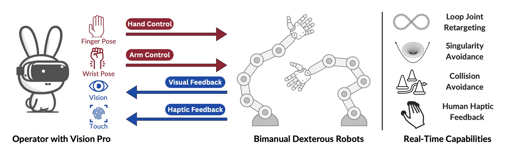
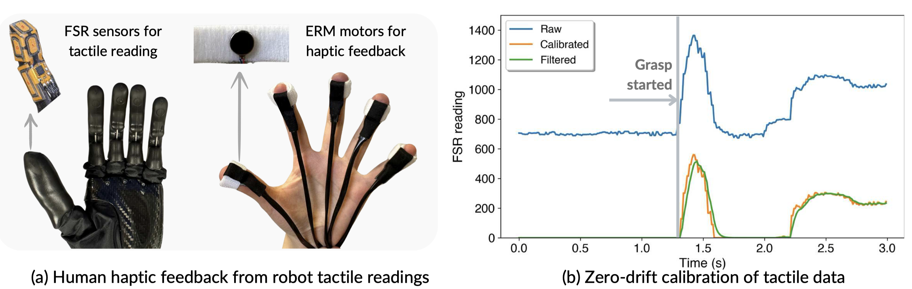

# 001 · Bunny-VisionPro

核查：2026-10-21｜论文：arXiv:2407.03162v1，2024-07-03｜状态：主笔记完成，未复现。

项目定位更新（2026-10-22）：本文为 [Cadenza Robotics](https://github.com/Jeffaaay/cadenza-robotics) 的遥操作与数据采集参考。当前先搭建 OpenArm 原结构平台并复现已有基准，灵巧手和弹琴待定；不表示已经选择复刻完整 Bunny 硬件。

**快速跳转：** [相比 2024 的进步](#progress) · [学术对照](#academic) · [公式](#math) · [实验](#experiments) · [图与视频](#media)

1. **它是什么？** Vision Pro 双臂灵巧手遥操作系统；ACT、Diffusion Policy、DP3 是拿来检验示范质量的已有算法。[论文](https://arxiv.org/html/2407.03162v1) · [代码](https://github.com/Dingry/BunnyVisionPro) · [视频与图](#media)

2. **解决什么失败？** 人的手在动，机器人却可能跟不上；两手位置不协调或关节突然大幅运动，会破坏共同拿容器等操作。

3. **流程是什么？** 人手追踪 → 手指映射与机械臂求解 → 实机执行并录制观察/动作 → 用录制数据训练策略 → 机器人看相机自主执行。遥操作控制与训练后的自主策略是两个阶段。

4. **具体改动？** 联动手指只优化主动关节；机械臂同时考虑跟随、碰撞、奇异位姿；初始化时对齐双手相对位置；另做指尖振动反馈。主采集实验没有用上后来开发的触觉反馈。AnyTeleop+ 与 Bunny 使用相同硬件。

5. **数学做什么？** 找到既像人手、又不过猛且不越限的关节角；机械臂再加入碰撞与奇异位姿惩罚。它们是实时优化，并非新训练出的三个神经网络。[公式与例子](#math)

6. **证据是什么？** 揭盖倒东西，ACT 用 AnyTeleop+ 数据为 2/10，用 Bunny 数据为 8/10；抓玩具则同为 8/10。原版长任务中，DP3 扫地和咖啡均为 4/10。[完整分母、配置与表号](#experiments)

7. **要什么资源？** 双 xArm 7、双 Ability Hand、双 L515、Vision Pro。短任务每项 50 次成功示范，长任务 30 次。论文未给训练 GPU、耗时、模型或数据包 GB；不能拿其他论文的数字冒充。[算力口径](#experiments)

8. **没证明什么？** 遮挡仍会影响手指追踪，轻微触碰的振动不明显。10 次测试不是生产可靠性验证。官方仓库的避碰、奇异位姿规避仍是未完成项，因此“代码可下载”不等于论文完整可复现。[固定版本证据](https://github.com/Dingry/BunnyVisionPro/blob/ea55fccf4d56209562310207b40395557fea778a/README.md#white_check_mark-todo)

9. **后来进步在哪？** 人手直接采集、同一手模块采集/部署、接管时同步手势并用纠错数据再训练、统一跨手测试。没有找到足够证据宣布某个后继在 Bunny 全部相同实验中全面胜出。[2025–2026 对照](#academic)

10. **我们的收获？** 数据采集接口本身会影响学习效果。接触丰富任务尤其值得检查：记录的是“人希望手指怎样动”，还是“被物体挡住后手实际动到哪”。先复现与测量，改平滑参数本身不自动构成新论文。[候选问题](#our-next-step)

11. **业界做到哪里？** Sunday 用与机器人末端相匹配的手套采集；Figure 将人类数据预训练用于长流程、跨家庭操作。它们的任务范围有所扩大，但公司演示与 Bunny 的同条件学术测试不是一回事。[业界证据与限制](#progress)

论文事实定位：§3，§4.1–4.2，§5，§6，附录 C/F。以下内容区分作者报告、公司报告和我们的解释；没有我们自己的机器人实测。

## 相比 2024 Bunny，进步在哪里？

**Bunny 的重点是把人手动作可靠地传给机器人，收集示范，再训练几个指定任务。后来的工作把问题延伸到：怎样更容易收集大量数据、怎样处理接触、怎样纠错、怎样进入新环境。** 这几条路线可以组合，不是全行业统一换掉了 Bunny。

### 1. 采集不一定要带着整台机器人

**Bunny：** 人戴 Vision Pro，让旁边的机器人跟着做。每次录制都依赖整套机械臂、机械手、相机与工作区。

**后来：** DexUMI 让人戴外骨骼直接操作物体，再转换人手图像与动作；RealDexUMI 更进一步，让人佩戴机械手末端模块采集，再把同一个模块装到机械臂。Sunday 也采用与机器人末端共同设计的采集手套及数据转换流程。

**为什么有用：** 要录“不同桌子上拿不同杯子”，有机会把采集设备带到场景里，而不必每次搬整台机器人。代价转移到了末端适配、视觉转换、动作可执行性与标定，问题没有凭空消失。RealDexUMI 的末端一致，也不意味着人的手臂与机械臂动力学一致。

依据：[DexUMI](https://dex-umi.github.io/)、[RealDexUMI](https://arxiv.org/html/2606.06033v2)、[Sunday](https://www.sunday.ai/blog/no-robot-data)。它们是替代采集路线，不能由此认定所有任务都比遥操作好。

### 2. 不仅要“手指弯到哪里”，还要知道“碰到了什么、该继续施多大作用”

**Bunny：** 已经有指尖压力和振动反馈，也测试过把触觉加入策略；但主要采集比较没有用到后来开发的反馈装置，策略加入触觉也没有稳定提高所有任务。不能写成“2024 完全没有触觉”。

**后来：** RealDexUMI 同步保存指令、实际手状态和触觉；DITTO-X 除接触振动外，还给操作者持续的关节力反馈。

**具体例子（解释）：** 手已经握住物体，操作者继续收紧，但手指被挡住，实际角度不再变化。只记“手指没动”，与记“仍在发收紧指令”，是两种不同的训练标签。插接、持工具等任务会关心这种差别。

**证据：** RealDexUMI 的 ACT 在 8 项任务上，每项 200 次示范、20 次测试：完整方案平均 88.75%；去掉触觉为 70%；改用实测手状态作动作标签为 51.25%。这是该论文内部的消融，支持这两项设计在其设置下有用；不是对 Bunny 的直接胜率。[RealDexUMI 实验表](https://arxiv.org/html/2606.06033v2) · [Bunny 表 6](https://arxiv.org/html/2407.03162v1#S5)

### 3. 从“录好示范再训练”，扩展到“失败时纠正，再学一次”

**Bunny：** 主要路线是收集成功示范，训练 ACT/DP/DP3，然后测试。论文没有验证一套部署中反复接管、纠错、再训练的流程。

**DITTO-X：** 机器人自主执行时，主动外骨骼让人的手跟随机器人当前手势。需要接管时，人已经处于匹配姿态；纠正过的轨迹再加入训练集，这种迭代方式称为 DAgger。

**具体失败：** 机器人正握着钳子，人却张着手。如果直接把控制权切给人，机器人可能瞬间松开工具。先同步手势，解决的是交接时的动作突变；再训练解决的是策略下次遇到类似状态怎么办。

**证据：** 钳子任务中，DITTO-X 示范训练的自主策略为 19/30；加入两轮、每轮 20 条纠错轨迹后为 26/30。作者还做了相同示范数量的非迭代对照，因此并非只比较“数据多”和“数据少”。人工接管片段属于辅助执行；上面的成功率是策略评估，不能混为一类。[论文结果表](https://arxiv.org/html/2610.00781v2) · [演示与对照](https://tml.stanford.edu/ditto-x/)

### 4. 从桌边固定工作区，扩展到需要身体移动的整段任务

**Bunny：** 双臂在固定工作区完成清洁、倒物、递交等操作。会抓杯子，不自动意味着能端着杯子走到厨房。

**Figure Helix 02：** 公司把系统分层：较慢的一层理解任务，中间层生成身体动作目标，快速低层维持平衡与接触。其低层结合人类动作数据和 sim-to-real 强化学习，操作还使用视觉、触觉与掌部相机。

**新增难点：** 走动时保持抓稳、移动身体获得视野、靠近柜子后再伸手。公司展示约 4 分钟跨区域装卸洗碗机流程，比固定桌面操作涉及更多协调。但该视频不能证明比 Bunny 更省算力、更便宜或长期更可靠。[Figure 2026-01-27 技术说明](https://www.figure.ai/news/helix-02)

### 5. 从“这套场景学会了”，推进到“换一个家还能做”

**Bunny：** 不是只测原场景，也测了新物体位置与未见物体；但没有验证跨很多真实家庭的移动操作。

**Figure Helix 2.5：** 公司先用 Index 人类行为数据预训练，再用其他环境中的任务数据微调；在 30 个未见家庭测试收玩具、叠毛巾、铺床。公司报告完整任务成功率：预训练后 56%，从零训练 9%，对照保持下游数据与训练配置一致。

**这里的进步：** 不只是把某一张桌子上的动作学得更准，而是让已有经验在不同家具、物体和布局中继续有用。这里的 zero-shot 指没在测试家庭/物体上训练，**不是完全没学过这些任务**。30 个家庭也不等于 30 次试验；本次没有提取逐任务试验分母，数字属于公司报告。[Figure 2026-09-17 报告](https://www.figure.ai/news/helix-2-5-zero-shot-30-home-generalization)

### 6. 更复杂的视频之外，开始有更统一的比较方式

**Bunny：** 有自己的真机任务与测试分母，但拿另一种机械手的论文来比，硬件与场景通常不一致。

**Bench2Dex：** 提供 12 种手、26 个双手任务、约 1.3K 条示范，以及统一扰动和评分方法。对于我们，“同一个任务换手后哪里失败”比各看一段最佳视频更容易解释。

它是 Isaac Lab 仿真测试平台，不是自动更强的策略，也不等于模拟触觉能直接替代实机触觉。要说改装手更好，仍需固定物体、数据量、训练方法和评分规则，最后做实机验证。[Bench2Dex](https://bench2dex.github.io/)

**对我们的判断：** 最值得先借鉴的是明确的任务测试、准确的数据标签和失败后的处理方式。暂时不需要模仿公司的全部规模；也不能把它们的能力进步全归功于某一个新网络。新硬件、传感器、数据量、控制与训练方法一起变了。

## 同类学术方法：截至 2026-10-21

问题是“在哪个环节进步了”，而不是“哪个年份更新”。下表是定向检索，未穷尽全部论文；没有发现这些工作对 Bunny 全部同硬件、同数据量、同任务的直接复测。

| 工作 / 日期 | 相对 Bunny 重点改变什么 | 公开证据 | 对我们的意义与限制 |
|---|---|---|---|
| [DexUMI，2025](https://dex-umi.github.io/) | 人穿戴外骨骼直接操作实物；通过硬件约束和图像中人手→机械手的替换，减少人机形态差异 | 作者报告两种机械手平台平均任务成功率 86%；有[官方代码](https://github.com/real-stanford/DexUMI)和硬件指南 | 采集时不用让整台机械臂一直跟随。仍需外骨骼适配与视觉数据处理；86% 不是对 Bunny 的胜率 |
| [DexWild，2025](https://dexwild.github.io/) | 在更多自然环境采人类手部数据，与机器人示范共同训练 | 作者报告未见环境成功率 68.5%，比其机器人数据单独训练基线显著提高；有采集与训练代码 | 重点是数据覆盖面。不能据此认为完全不需要机器人数据；没有与 Bunny 同条件对比 |
| [RealDexUMI，2026-06-04；v2 06-06](https://arxiv.org/html/2606.06033v2) | 人佩戴同一个机械手/相机/触觉模块采集，随后把它装到机械臂上；保存指令与实际状态的差别 | ACT 主实验：8 项真机任务，每项 200 次示范、20 次测试；完整任务平均 88.75%，无触觉 70%，用实际状态替代动作标签 51.25% | “采集与部署末端一致”值得研究，但不等于整台机器人零差异。它的示范数比 Bunny 多，任务也不同 |
| [DITTO-X，2026-09-30；v2 10-05](https://arxiv.org/html/2610.00781v2) | 主动外骨骼提供力/接触反馈；自主执行时反向带动人手同步姿态，接管后收集纠错数据 | 钳子任务，DITTO-X 数据训练策略 63.3%，MANUS 数据为 13.3%，各 30 次；两轮 DAgger 后前者完整任务 86.7% | 改进的是接触反馈与人机交接；接管实验不是全自主。论文声明开源，项目页的 Code/Dataset/Hardware Guide 本次未发现可点击发布链接，下载可用性未确认 |
| [Bench2Dex，2026-09-14](https://arxiv.org/abs/2609.15726v1) | 用统一仿真任务和扰动测试不同机械手、策略与模态 | 12 种手、26 项任务、约 1.3K 遥操作示范；含 ACT、DP、π₀.₅、GR00T N1.5 基线 | 它是测试框架，不是击败 Bunny 的新遥操作器；基于 Isaac Lab，不能直接当 MuJoCo 项目运行；模拟触觉不是已验证的实物触觉 |

## 业界方案速查

核查：2026-10-21。以下是**公司自己的技术披露**，不是我们的独立验证，也不是与 Bunny 的同条件测试。

| 公司 / 工作 | 方法上的变化 | 展示或报告的任务 | 能下什么结论 / 不能下什么结论 |
|---|---|---|---|
| [Sunday / ACT-1](https://www.sunday.ai/blog/no-robot-data)；文章本次未核实明确发布日期 | Skill Capture Glove 与 Memo 末端共同设计，匹配几何和传感器；Skill Transform 转换运动与视觉数据，训练机器人策略 | 公司报告餐桌→洗碗机长流程：21 个物体、68 次交互，包含易碎餐具、倒残渣与移动 | 展示任务范围大于固定桌面；未在该页找到这整段任务的重复测试成功分母。数据转换成功率不能当任务成功率 |
| [Figure / Helix 02，2026-01-27](https://www.figure.ai/news/helix-02) | 分层控制把语义、视觉动作与全身低层控制连接起来；低层结合人类动作数据和 sim-to-real RL，增加触觉与掌部相机 | 公司展示约 4 分钟自主装卸洗碗机、跨房间搬运 | 显示移动、接触与操作的结合；展示视频不能推出量产可靠性。不是“纯遥操作”或“纯 RL”二选一 |
| [Figure / Helix 2.5，2026-09-17](https://www.figure.ai/news/helix-2-5-zero-shot-30-home-generalization) | 在 Index 人类行为数据上预训练，再用其他环境的机器人数据指定任务 | 在 30 个未见家庭做整理玩具、叠毛巾、铺床；公司报告整任务成功率预训练 56%，从零训练 9% | 提供公司内部受控对照，强于只给精选视频；本次未核实逐任务试验分母。30 个家庭不等于 30 次试验，“zero-shot”针对环境/物体，不代表没有任务训练 |

**名字提醒：Sunday 的 ACT-1 是公司模型名称，不能当作 ALOHA 的 ACT 算法实现。**

本次未核实到上述公司提供可直接部署到 OpenArm 的完整权重、数据与控制栈。公开能力展示不能等同于我们能直接复现。

展开：完整公式、符号解释与计算例子

来源：[论文 v1 §3.2–3.3，公式 1–6](https://arxiv.org/html/2407.03162v1#S3)。以下公式来自论文，例子为我们的教学解释，不是作者实验。这里只讲遥操作控制；ACT/DP/DP3 是另外的训练阶段。

### 1. 手指要像人手，也不要突然跳动

$$
L_{hand}=\sum_{i=1}^{N}\|\alpha v_i-\mathrm{FK}_i(q)\|_2^2+\beta\|\Delta q\|_2^2,
\qquad q^l\le q\le q^u.
$$

| 符号 | 实际是什么 / 从哪里来 |
|---|---|
| $q$ | 要求解的机器人关节角 |
| $v_i$ | 从追踪到的人手关键点算出的向量 |
| $\alpha$ | 人手与机械手尺寸不同，用比例调整 |
| $\mathrm{FK}_i(q)$ | 把候选角度放进机械手几何模型，算对应向量；FK 是正运动学 |
| $\Delta q$ | 本帧角度减上一帧角度 |
| $\beta$ | 平滑这一项有多重要 |
| $q^l,q^u$ | 关节允许的角度下限、上限 |

直觉：第一项要求“跟得像”，第二项要求“别跳得太猛”。$\beta$ 更大通常更平滑，也可能更跟不上；不是越大越好。平方让较大的误差受到更重惩罚。

实际循环：读取追踪 → 带入上一帧角度 → 用 SQP（逐步求解局部近似问题）找更小的损失 → 把角度发给手。这里求的是关节角，不是在训练网络权重。

### 2. 联动关节不用各自独立搜索

$$q_j=c_j(q_1,\ldots,q_k),\qquad j=k+1,\ldots,n.$$

$n$ 是模型中的全部关节数，$k$ 是主动关节数。$c_j$ 来自机械连杆几何：主动关节一动，被动关节的角度就受它决定。Bunny 只搜索 $k$ 个主动角度，其余用 $c_j$ 算出。

$$
\frac{dL}{dq_i}=\frac{\partial L}{\partial q_i}+\sum_{j=k+1}^{n}\frac{\partial c_j}{\partial q_i}\frac{\partial L}{\partial q_j}.
$$

这是链式法则：主动关节既直接影响损失，又通过被动关节间接影响损失；两个影响都要算。

**教学例子：** 假设被动角 $q_2=0.5q_1$，损失对两角的偏导分别为 2 和 6，则主动角的总梯度为 $2+0.5\times6=5$。真实四连杆通常不是这个简单比例。

作者报告：同一测试 CPU 上，把联动作为额外约束耗时 34.98ms，降维方法为 3.43ms，约快 10.2 倍。这是映射模块测速，不是整机端到端延迟。

### 3. 机械臂既要跟随，也要避开麻烦姿态

$$L_{arm}=L_{ik}+L_{sin}+L_{col}.$$

三项依次是：到达目标位置/朝向、避免奇异姿态、避免自身碰撞。IK 是逆运动学：已知手要到哪，反求各关节角。

$$
L_{ik}=\beta_{pos}\|p_{ee}-p_{wrist}\|_2+
\beta_{rot}\arccos\!\left(2\langle q_{ee},q_{wrist}\rangle^2-1\right).
$$

$p$ 是位置；这一式里的 $q$ 是表示朝向的**单位四元数**，与前面表示关节角的 $q$ 不是同一个意思。$ee$ 是机器人末端，$wrist$ 是映射到机器人参考坐标系的手腕目标。两种 $\beta$ 用来权衡位置与朝向。

直觉：手到了杯子旁边但掌心方向错了，仍然抓不了，因此既比较位置，也比较方向。坐标变换与初始化是这一步能正确工作的前提。

### 4. 什么叫奇异姿态惩罚？

$$
L_{sin}=\begin{cases}
1-\dfrac{\sqrt{\det(JJ^T)}}{\lambda},&s_0<s_{low},\\
0,&\text{其他情况}.
\end{cases}
$$

$J$ 是雅可比矩阵，把“关节怎么小幅转动”映射成“末端怎么小幅移动”。$s_0$ 是其最小奇异值，$s_{low}$ 是触发阈值；$\sqrt{\det(JJ^T)}$ 是可操作度指标，$\lambda$ 调整尺度。

直觉：有些接近伸直的姿态，末端想往某个方向挪一点，却需要关节大幅转动。接近这类状态时加罚分，鼓励换一个更容易运动的姿态。阈值触发与优化目标是两个不同的量。

### 5. 碰撞怎样放进公式？

$$
L_{col}=\frac{1}{\sum_{i=1}^{m}\sum_{j=1}^{m}\mathrm{dist}(e_i,e_j)\,\mathbb{1}(e_i,e_j)+\epsilon}.
$$

按论文原式记录：把连杆近似成球集合；$e_i$ 是球，$\mathrm{dist}$ 是球间距离项，指示函数决定哪些球对需要检查；同一连杆及直接相邻连杆的部分检查被排除，$\epsilon$ 防止分母为零。

**解释与边界：** 距离聚合项变小时罚分变大。但“距离之和的倒数”不是逐对的硬性不碰撞约束，不能从此式推出每对球都安全，也不能推出它能躲开所有环境障碍。球半径、距离实现与有效球对必须结合代码核实。

### 从公式到我们自己的验证

先验证 FK、坐标系和关节限位，再测跟踪误差/延迟/最小距离。不要只看手臂动得好不好看。避碰与奇异规避在[官方 README 固定版本](https://github.com/Dingry/BunnyVisionPro/blob/ea55fccf4d56209562310207b40395557fea778a/README.md)中仍未勾选，因此这里是论文解释，不是已完成的代码复现。

展开：Bunny 原实验、训练配置与资源

所有 Bunny 数字来自 [v1 表 1、3、4、5 与附录 C/F](https://arxiv.org/html/2407.03162v1)，不是我们实测。

### 自主任务

| 任务 | 每套数据的成功示范数 | ACT：AnyTeleop+ → Bunny | DP：AnyTeleop+ → Bunny | DP3：AnyTeleop+ → Bunny |
|---|---:|---|---|---|
| 玩具放盒 | 50 | 8/10 → 8/10 | 4/10 → 7/10 | 10/10 → 10/10 |
| 海绵清锅 | 50 | 7/10 → 9/10 | 5/10 → 7/10 | 6/10 → 8/10 |
| 揭盖倒物 | 50 | 2/10 → 8/10 | 3/10 → 6/10 | 5/10 → 7/10 |
| 擦玻璃 | 30 | 未报告 | 未报告 | Bunny 7/10 |
| 扫地倒垃圾 | 30 | 未报告 | 未报告 | Bunny 4/10 |
| 倒咖啡、搅拌、递交 | 30 | 未报告 | 未报告 | Bunny 4/10 |

以上为常规场景完整任务成功，未混入新位置/新物体的泛化列，也未混入子任务成功。10 次测试的分辨率是 10 个百分点，不能由此断言长期可靠性。论文文字中长任务平均数与表 5 有出入，本库保留逐项分子/分母，不重复该文字平均数。

### 训练配置

| 算法 | 视觉输入 | 时间配置 | 训练轮数 | batch size |
|---|---|---|---:|---:|
| ACT | 多视角 RGB | chunk 20 | 3,000 | 未注明 |
| Diffusion Policy | 多视角 RGB | horizon 8：2 观察、6 动作 | 300 | 64 |
| DP3 | 多视角点云 | 同上 | 500 | 64 |

相机数据约 30Hz、机器人本体状态超过 100Hz，时间对齐后下采样为 10Hz 训练。10Hz 是数据采样率，不是已经测出的部署推理速度。

### 资源口径

| 项目 | Bunny 实际公开信息 |
|---|---|
| 硬件 | 2 × xArm 7；2 × 6-DoF Ability Hand；2 × RealSense L515；Apple Vision Pro |
| 遥操作模块测速 CPU | Intel i7-12700KF |
| 手指映射 / 含避碰与奇异处理的机械臂控制 | 3.43ms / 15.93ms；模块级测速 |
| 训练 GPU、显存峰值、训练小时 | 论文未公布 |
| 数据包、模型权重、完整检查点 GB | 论文未公布 |
| 自主策略部署延迟、机载设备 | 论文未公布 |
| 当前完整采购成本 | 本次未核查；不沿用不明年份报价 |

**不能把“遥操作可在 CPU 上运行”写成“训练后的 ACT/DP3 都不用 GPU”。**

外部尺度，仅作参考：[原版 ACT](https://arxiv.org/html/2304.13705)约 80M 参数，单张 RTX 2080 Ti（11GB 容量）训练约 5 小时，推理约 10ms；80M × 4 字节的纯 FP32 权重计算值为 0.32GB。[DP3 官方实现](https://github.com/YanjieZe/3D-Diffusion-Policy#-benchmark-of-dp3)报告训练约用 10GB 显存，在 A40 上约 3 小时。它们不是 Bunny 的实测，也不是同条件的算法速度排行榜。

展开：论文 PDF、关键图与视频链接

核查：2026-10-21。PDF 和下列两图保存学习副本；视频保存可播放的官方入口，**没有把视频文件下载进 Git**。视频的自主/遥操作标签依据作者描述，不代表我们独立核实每一帧。

### Bunny

- [本地 PDF：2407.03162v1](bunny-visionpro-v1.pdf) · [原始版本](https://arxiv.org/pdf/2407.03162v1)
- [官方总览视频](https://www.youtube.com/watch?v=NSJV9rA5y4I)：同时介绍系统与实验，不能把所有片段都当自主。
- [官方自主模仿学习视频](https://dingry.github.io/projects/bunny_file/videos/il.mp4)：观察任务步骤、停顿与失败恢复；精选片段不是成功率分母。
- [无触觉递交](https://dingry.github.io/projects/bunny_file/videos/haptics/handover_wo_haptics.mp4) / [有触觉递交](https://dingry.github.io/projects/bunny_file/videos/haptics/handover_w_haptics.mp4)：这是人类遥操作反馈比较。
- [完整项目页](https://dingry.github.io/projects/bunny_visionpro.html)：按作者分组查看泛化与触觉实验。

图源：[Bunny 项目系统图](https://dingry.github.io/projects/bunny_file/img/teleop_system.png)。看人手输入、机械臂/手控制、相机观察分别在哪里。

图源：[Bunny 项目触觉图](https://dingry.github.io/projects/bunny_file/img/haptic_device.png)。看压力读数如何传到振动反馈；该模块未参与主要示范采集对比。

### 后续方法与业界视频索引

| 入口 | 看哪一段 | 需要分清什么 |
|---|---|---|
| [DexUMI](https://dex-umi.github.io/) | 人采集与机器人复现；采集效率对照 | 人直接操作的采集视频 ≠ 机器人自主成功 |
| [DexWild](https://dexwild.github.io/) | 自然环境采集与跨环境部署 | 人类数据与机器人数据共同使用 |
| [RealDexUMI](https://research.beingbeyond.com/realdexumi) | 佩戴模块采集、装臂执行、插头/鸡蛋等任务 | 同末端不代表所有机械臂动力学相同 |
| [DITTO-X](https://tml.stanford.edu/ditto-x/) | Autonomous Policies 与 Reverse Teleoperation | 自主视频与人工接管视频分别标注；接管不是纯自主 |
| [Bench2Dex](https://bench2dex.github.io/) | 多手型任务与仿真触觉 | 仿真结果不自动等于实机结果 |
| [Sunday ACT-1](https://www.sunday.ai/blog/no-robot-data) | Table-to-Dishwasher | 公司演示，重复试验分母待核查 |
| [Figure Helix 2.5](https://www.figure.ai/news/helix-2-5-zero-shot-30-home-generalization) | 三类家庭任务与恢复动作 | 公司实验报告；按其定义解释 zero-shot |

第三方论文与图片权利归原作者；本库学习注释不是其官方文档。资产来源在对应图片和论文链接旁注明。

展开：我们可以做的验证（尚未执行）

状态：候选问题，**尚未执行，也尚未证明研究新颖性**。不要把它们直接写成论文贡献。

| 问题 | 已有研究提醒 | 我们可先做的最小实验 | 记录什么 |
|---|---|---|---|
| OpenArm 夹爪/机械手碰到物体后，指令与实际状态差异多大？ | RealDexUMI 已经研究 action-state correspondence；不能把概念当自己的创新 | 同步录目标指令、实测关节位置、电流、相机；检查接触前后差别 | 时间对齐误差、动作饱和、接触时标签差异 |
| 人从自主策略接管时，会不会突然松开或挤压物体？ | DITTO-X 已经提出同步人手机制 | 先在仿真比较直接切换与姿态匹配后切换 | 接管关节跳变、物体掉落、可恢复比例 |
| 更换机械手后，失败来自硬件还是学习？ | Bench2Dex 提供跨手评估思路，仿真触觉仍有限制 | 在同一场景、相同物体和任务定义下，先比较原夹爪与候选手的可达性和脚本动作 | 可达范围、碰撞、负载、动作可行性；再单独比较策略 |

第一步先选一个低成本、可观察的问题做测量。想成为论文，还需要说明现有方法为什么没有解决我们的条件，并用合适 baseline 与重复试验支撑结论。

实验记录直接追加在本页；一次只改变一个主要变量；收集与测试分开，防止把训练场景的成功误当泛化。

