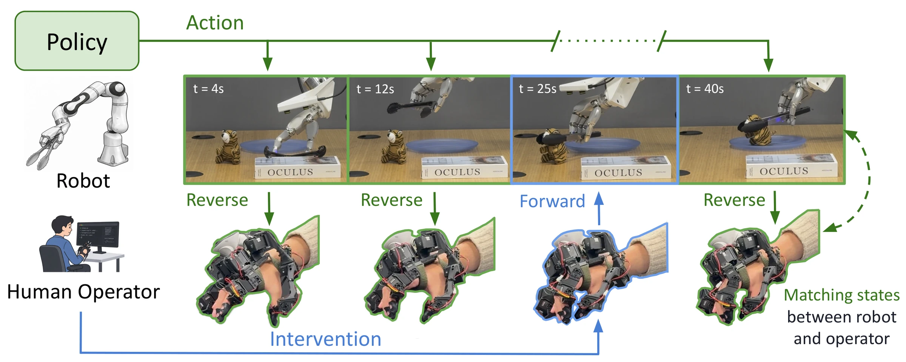
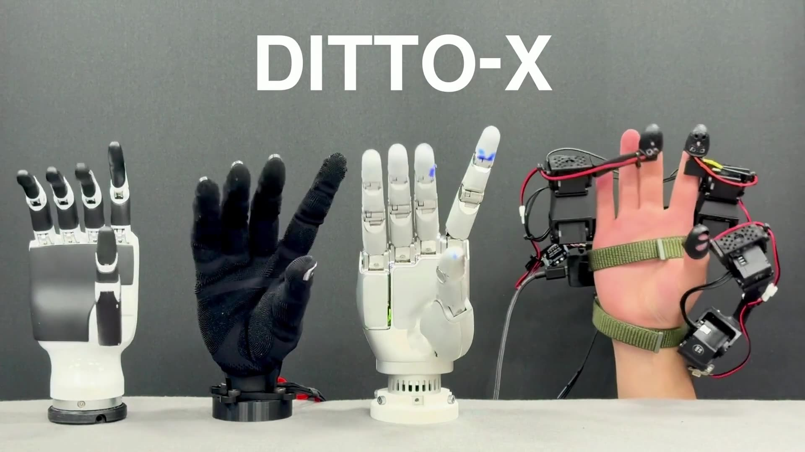

# DITTO-X：接管前先同步人的手，接管后用纠错数据再训练

**[打开图片与视频播放页](media.html)** · 图片保存在本文件夹；视频播放页在线载入作者原视频。GitHub 的 README 不保证播放 HTML 视频，可在 Chrome 中打开 media.html，或使用文末官方链接。本机 Codex 内置浏览器播放原视频时出现崩溃。

核查：2026-10-21｜论文：arXiv:2610.00781v2｜状态：文献与公开资源分析，未复现。

项目定位更新（2026-10-22）：为 [Cadenza Robotics](https://github.com/Jeffaaay/cadenza-robotics) 保留接管、姿态同步与反馈的研究参考；当前先复现 OpenArm 已有遥操作基准，不将 DITTO-X 视为已经选定的硬件或必装组件。

沿用现有 robotics-research-notes 的十一项问题。论文报告、演示、我们的推断分别标明；本文不构成硬件选型结论。

## 1. 它是什么？先把人、机械臂、机械手分开

DITTO-X 是双向手部遥操作和接管接口。自主学习使用另外的策略网络；外骨骼本身不是那个网络。

| 名称 | 在整套系统中做什么 |
|---|---|
| DITTO-X 主动外骨骼 | 人操作的手部接口；既读取动作，也能驱动人的手指 |
| Quest 控制器 | 跟踪手部接口的位置和方向，给机械臂提供腕部运动目标；不是机械手 |
| Franka Panda | 负责搬动整个机械手的机械臂 |
| Sharpa Wave | 装在机械臂末端、实际接触物体的机械手 |
| 相机与策略网络 | 记录示范；训练后根据观察生成机器人动作 |

论文使用 Quest 3S 系统和 Panda 采集；兼容手包括 Wave、Wuji 2、Inspire。只有拇指、食指、中指独立接入外骨骼，机械手的无名指、小指随中指联动。不能把五指机械手理解为“五根人手指都独立遥控”。[论文 §III–IV](https://arxiv.org/html/2610.00781v2)

## 2. 它解决什么具体失败？

看“拿夹子夹玩具”的例子。机器人已经握住夹子，人的手却张开着。如果直接切换到人的指令，机器人可能突然松手。操作者还有第二个困难：看到夹子没有掉，不代表知道自己是否夹得过紧。

DITTO-X 的接管示例让外骨骼先跟随策略的手姿，再允许人接管、修正，随后还给策略；项目页也提供 MANUS 手套对照。[接管视频与说明](https://tml.stanford.edu/ditto-x/)

与 Bunny 的差别应表述为：已有 Bunny 笔记重点是动作映射、机械臂求解和示范采集；这里进一步处理“自主执行到一半怎样平顺接管，再利用纠错数据”。不能说 Bunny 完全没有触觉，也没有同条件证据说 DITTO-X 全面胜过 Bunny。

## 3. 从人示范到机器人自主运行

人戴外骨骼操作 → 机器人执行并记录相机、状态、动作及可用触觉 → 用 Diffusion Policy 学习 → 策略自主执行 → 人在失败前接管 → 把纠错轨迹加入数据，再训练。

自主阶段的观察包括图像、末端姿态、机械手关节状态及可用触觉；输出控制机械手和末端运动。此时人可以监督，但“有人接管后完成”不能计作无人协助成功。

这些流程与实验数据已记在原仓库 Bunny 笔记的“失败时纠正，再学一次”部分；原始依据为[论文 §IV](https://arxiv.org/html/2610.00781v2)。

## 4. 实际改了哪里？

项目的关键是双向接口：正向把人的动作送给机器人，反向把策略的手姿投射回外骨骼，并提供接触反馈。反向同步具体指策略命令的姿态，不应理解成接触受阻时人的手和机器人实际关节角仍严格一致。[项目说明](https://tml.stanford.edu/ditto-x/)

**我们的分析：** 这里有三个可分开的工程问题：动作怎样映射、力量怎样反馈、控制权怎样切换。换一只手时，只写第一项远远不够。例如新手没有可靠的力或电流反馈，动作仍可能跟随，但“能感觉到夹紧程度”的功能已经改变。相同品牌外骨骼也不会自动消除这些差别。

## 5. 数学到底帮助了哪个动作？

用下面的教学表达理解，不把它当论文原式：

`机器人目标 = 正向映射(人的接口状态)`

`人的跟随目标 ≈ 反向映射(策略给机器人的目标)`

“约等于”很重要：若五根机器人手指被压缩成三根独立操控的手指，这个映射不能恢复所有信息。就像把两路音轨混成一路后，不能仅凭混合结果唯一拆回去。

纠错学习可理解为 `新数据集 = 原示范 + 新遇到的失败附近的正确处理`。作用不是给网络改名字，而是让训练覆盖它真正会走到的危险状态。

**教学例子：** 原示范全是夹子放得很正，机器人偏着抓时就不会处理。纠错轨迹包含“已偏着握住 → 调整抓法 → 再夹玩具”，这是从头重录一次完美示范不一定包含的信息。例子是解释，非新增实验结果。

## 6. 证据是什么？

现有仓库已收录的钳子任务结果：初始自主策略 **19/30**；两轮纠错、每轮增加 20 条轨迹后 **26/30**。论文另设相同示范数量的非迭代对照。[论文结果](https://arxiv.org/html/2610.00781v2)

接管用户研究为 6 人、每接口每人 10 次；项目页把掉落工具列为失败。[研究条件和对应视频](https://tml.stanford.edu/ditto-x/)

**证据的解释：** 自主评估与人工接管评估回答不同问题。前者问策略学得怎样，后者问接口能不能帮助人救回来。接口对比还同时改变反馈与同步方式，不能凭总胜率把全部提升单独归因于某一个部件。更不能把抓夹子的结果外推成高速五指独立弹琴能力。

## 7. 要什么资源？现在能复刻到哪一步？

截至本次核查，项目主页可看论文和视频；Code、Dataset、Hardware Guide 入口仍是 Coming soon 占位。论文宣称将公开与实际可下载必须分开，未核实到可直接部署的完整权重包。[官方入口](https://tml.stanford.edu/ditto-x/)

**我们的复刻依赖分析：**

| 依赖 | 缺少时会卡在哪里 |
|---|---|
| 外骨骼 CAD、BOM、固件、装配与校准说明 | 无法证明自制接口与论文接口等价 |
| 目标手驱动及反馈标定 | 指令能动不等于反馈可信 |
| 机械臂控制、相机时序、动作日志 | 无法重建完整示范与接管过程 |
| 训练配置、数据划分、检查点 | 无法按原条件比较策略结果 |

当前适合做原理和接口审查。公开状态尚不足以承诺按文档完整复现；也没有可靠资料可据此估算我们所需 GPU 显存或训练时间。

## 8. 能换成 OpenArm 吗？没证明什么？

**工程判断：可以研究移植，不是已有 OpenArm 支持。** 三种手的演示证明了接口有适配能力，不等于任意机械臂、任意手都能直接运行原权重。

| 换的部分 | 我们需要改什么 | 应怎样验证 |
|---|---|---|
| Panda → OpenArm，机械手保留 | 末端坐标变换、IK、驱动、关节限制、时序 | 相同腕部目标能否平滑到达，是否碰撞或超出范围 |
| 机械手换型号 | 正反向映射、反馈量纲、限位和指令接口 | 抓住物体时切换，是否发生突然松开或夹紧 |
| 相机或安装位置改变 | 外参与观察分布、数据采集配置 | 原策略是否还看到训练时对应的物体和手 |
| 要复用学习策略 | 检查观察和动作的维度、含义及分布 | 同任务独立测试；不能只看程序未报错 |

人的动作可能超出机械臂工作空间，接管还涉及速度和延迟，单凭“OpenArm 也是七自由度”不能保证成功。

## 9. 后续方法与进展怎样看？

当前核对的是 DITTO-X v2，不把旧 DITTO 的资料当作 X 的完整硬件发布。本次未完成“所有后续论文”的系统检索，不能宣布它已被某个新方法全面替代。

与 RealDexUMI 的对照应看采集场景：一个是在机器人执行时遥控和接管，另一个让人携带部署用的末端模块采集。它们不是必须串联安装的软件。

## 10. 对我们的研究有什么用？

当前把它当作“接触任务接管接口”的参考，关注控制权切换、指令跳变与纠错数据。若以后恢复钢琴方向，还需要独立指法、腕部换位和可重复节奏；三指独立、其余联动的接口是否足够，必须先看具体动作。

候选研究假设：模块更换后，如果接管前先同步实际可实现的姿态，纠错数据是否更稳定？这还需要定义对照、耗时、失败次数和操作者差异，不能直接称为论文贡献。

## 11. 业界对照：看什么，不能比较什么？

Wave、Wuji、Inspire 是机器人手，不是不同名字的学习算法。商业手出现在视频里，不能证明其机械设计、固件或全部策略已开源。判断可维修性需要另查零件、驱动、标定和维修资料。

对我们有用的比较是同一个动作能否执行、接管是否平顺、反馈是否可靠、采集一分钟有效数据要花多久；不同视频各成功一次不能排出性能顺序。

## 图与视频：带着问题看

图为作者素材。看控制权交接的时间线，不要把图中“人的手也在动”误判为整个过程都在遥操作。

| 官方视频 | 重点观察 |
|---|---|
| [完整介绍](https://tml.stanford.edu/ditto-x/videos/supp-full-public.mp4) | 哪一侧是操作者接口，哪一侧是机械手 |
| [反向遥操作](https://tml.stanford.edu/ditto-x/videos/rt-concept.mp4) | 机器人自主时外骨骼为何仍在带动人的手 |
| [DITTO-X 接管夹子](https://tml.stanford.edu/ditto-x/videos/rt-ditto-tong.mp4) | 交接前后抓握是否连续 |
| [MANUS 对照](https://tml.stanford.edu/ditto-x/videos/rt-manus-tong.mp4) | 失稳出现在哪一刻，不只看最后掉没掉 |

视频是机制证据和示例，不代替测试分母。本文未对全部录像逐帧评分。

### 补充图片与来源

图片来源：[接管时间线](https://tml.stanford.edu/ditto-x/figures/teaser-rt.webp)。对照人的接口与机器人的手。策略执行和人工接管是不同阶段。

用于识别系统外观；封面不代表实验成功率。 [作者原图](https://tml.stanford.edu/ditto-x/videos/supp-full-public-poster.jpg)
