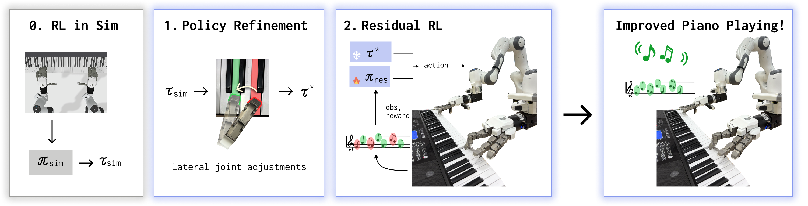
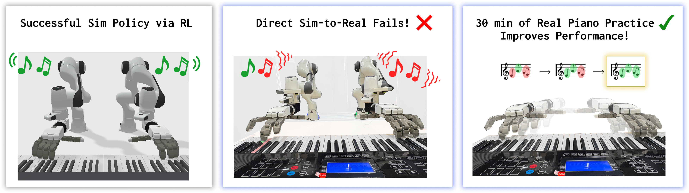
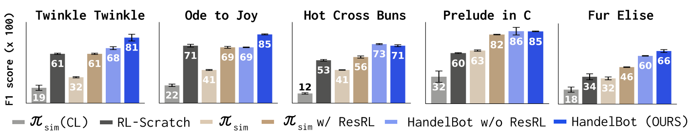

# HandelBot：仿真给出弹奏基础，再用实体琴键反馈修正

**[打开图片与视频播放页](media.html)** · 图片保存在本文件夹；视频播放页在线载入作者原视频。GitHub 的 README 不保证播放 HTML 视频，可在 Chrome 中打开 media.html，或使用文末官方链接。本机 Codex 内置浏览器播放原视频时出现崩溃。

核查：2026-10-21｜论文：arXiv:2603.12243v4｜状态：论文、视频入口及代码说明核查，未运行或复现。

项目定位更新（2026-10-22）：[Cadenza Robotics](https://github.com/Jeffaaay/cadenza-robotics) 当前先搭建 OpenArm 原结构平台并建立遥操作基准。灵巧手选型与弹琴暂缓，本文作为后续参考，不再把 LEAP v1 或 HandelBot 列为当前优先实施项。

沿用现有 robotics-research-notes 的十一项问题。重点回答：手臂是否运动、有没有学习人类动作、大手指造成什么问题，以及换成 OpenArm 和另一只手意味着什么。

## 1. 它是什么？

它是一套实体双手弹琴的仿真学习与实机适配方法。用户交接材料列出的硬件与论文一致：两只 Tesollo DG-5F，配 Panda 和 FR3 两条机械臂，用 MIDI 键盘报告实际音符。

Panda、FR3 是机械臂，负责移动整只手；DG-5F 是机械手型号。五首曲目是任务集合；episode/rollout 是一次执行轨迹。型号、任务数和实验次数不能混用。

[论文与硬件图](https://arxiv.org/html/2603.12243v4) · [官方演示](https://amberxie88.github.io/handelbot/)

## 2. 解决什么具体失败？

项目针对仿真弹得好、实机却按偏的问题：先修正手指横向对齐，再学习剩余小误差。用 MIDI 判断按到了什么，形成实机学习反馈。[官方方法说明](https://amberxie88.github.io/handelbot/)

**教学例子：** 仿真认为指尖对准 C；装配偏差让实机压到旁边的键。第一阶段处理“整体偏哪边”，第二阶段处理仍存在的接触、动作和时序问题。这个例子解释分阶段的必要性，不是新的实测结果。

与 Bunny 的区别：Bunny 先收人类遥操作示范；这里先从仿真任务奖励学习。两条路线处理的瓶颈不同，不能把它们理解为同一套系统的不同版本。

## 3. 流程，以及自主时究竟在做什么

ManiSkill 中训练 → 选取仿真轨迹作为基础 → 实机按键并按 MIDI 修正横向偏差 → 在基础轨迹上进行残差强化学习 → 执行修正后的弹奏。[项目流程图](https://amberxie88.github.io/handelbot/)

人不需要佩戴示范设备。乐谱任务、机器人状态和轨迹提供控制所需上下文；MIDI 提供实际按键反馈。输出包括机械手关节目标，机械臂另按脚本移动。不能把每个可见动作都归为网络自主学到，也不能把它叫作人类钢琴动作模仿学习。

## 4. 你的两个批评，哪些已有证据？

**“只有手指动”不准确；“没有学习人的完整弹琴动作”准确。** 机械臂跟随脚本化末端位置轨迹，腕部方向固定。论文承认这限制了拇指、小指及复杂曲目；实验改为每手三指。论文硬件图也明确指出机械手比普通人手大、增加弹奏难度。[论文 §IV、§V 与图 2](https://arxiv.org/html/2603.12243v4)

**我们的判断：** 这些是实质限制，但尚不能把“没有模仿人”单独判为最大失败原因。缺少模仿数据、固定手腕、手的几何限制是不同变量。强化学习也可能学出有效腕指协同；模仿学习也可能因为机器人结构不同而无法复现人类指法。

更精确的研究问题是：允许腕部旋转并学习腕指协同后，能否在同样手、同样曲目和同样实机预算下，减少误按、增加可用指法？这样才有可比较的对照。

## 5. 数学怎样对应一次真实按键？

教学简写：`最终关节目标 = 已修正的基础目标 + 学到的小修正`。

例如基础目标已经把手指送到键上方，小修正只调整有限幅度。这样把学习问题集中在剩余误差上；它不意味着小修正能补救所有机械不可达情况。

F1 用来综合漏按和误按：`F1 = 2 × 查准率 × 召回率 / (查准率 + 召回率)`。查准率（precision）问发出的按键中有多少正确；召回率问目标按键完成多少。具体计分还取决于论文的时间对齐和按键定义，不能直接等同于整首演奏成功率。

**自拟算例：** 应有 10 个事件，实际发出 10 个，其中 8 个正确、2 个错误且漏了另 2 个，则事件级 precision 与 recall 均为 0.8。这只是解释 F1，不是论文计分脚本或实验结果；两个系统同为 0.8，也可能一个节奏错、另一个集中漏掉和弦。

## 6. 五首曲目究竟测了几次？

每种方法报告五次 rollout 的平均 F1。实机 RL 训练 100 条轨迹，每 20 条做五次评估，最后取训练过程中的最高验证均值。短曲的交互预算约半小时，较长曲约一小时。因而“五首”不是“五次”，“30 分钟”也不是全部复刻时间。[论文 §IV-A5](https://arxiv.org/html/2603.12243v4)

**证据解释：** 最高验证成绩与最终固定检查点的独立测试是不同统计口径。它支持作者方法在所测设置下有效，不等于任意曲目、任意新位置都能稳定演奏。我们将来还应留出独立评估、记录每次失败，并报告误差随实机交互预算的变化。

官网提供五首曲目和多种方法视频；视频旁的参考 MP3 不能当作机器人实际音频表现的独立证据。[视频页面](https://amberxie88.github.io/handelbot/)

## 7. 公开代码与复刻地图

官方仓库实际有 `agents`、`assets/tesollo_delto`、`envs`、`music_data`、`rl`、`real`，并给出 `rl.piano_ppo_fast` 仿真训练入口及各曲目的 horizon。它比只有视频的项目更接近可复刻，但公开目录本身不证明我们已跑通。[仓库 README](https://github.com/amberxie88/handelbot)

实机说明使用 Ubuntu 22.04、ROS 2 Humble、JAX/PyRoki，分别启动两手控制、插值、refinement，以及残差 RL 的 actor/learner；DG-5F 使用 Ethernet Developer Mode。需要修改对应硬件与训练配置。[实机 README](https://github.com/amberxie88/handelbot/blob/main/real/src/dg5f_driver/README.md)

| 复刻层次 | 应确认的结果 |
|---|---|
| 读代码与配置 | 曲谱、手模型、动作、奖励和运行入口相互对应 |
| 原手仿真 | 不只加载画面，而是训练或评估得到可检查的按键轨迹 |
| 原硬件适配 | 驱动、键盘 MIDI、坐标、控制周期和反馈实际对应 |
| 重现论文结果 | 相同统计口径与预算，并保留所有 rollout |
| 换 OpenArm 或换手 | 单独说明新增适配，不能继续称为不变条件的复现 |

本次仅阅读和分析，没有安装、启动训练或控制设备。完整预训练权重、训练显存和端到端耗时未充分核实；不要把演示视频时长当训练时间。

## 8. 换机械臂、换机械手分别意味着什么？

**工程判断：同一仿真环境是起点，不是充分条件。**

| 层次 | 必须回答的问题 |
|---|---|
| 模型能加载 | URDF/资产、关节树和碰撞体是否有效？ |
| 机械上能完成 | 指尖进得去吗，够得到吗，邻指会碰吗，释放够快吗？ |
| 能重新训练 | 新动作空间、观察、奖励和控制器是否定义正确？ |
| 能直接用旧策略 | 每个输入输出的物理含义是否一致，训练分布是否仍适用？ |
| 仿真能到实机 | 延迟、刚度、摩擦、间隙与温升是否会破坏接触和时序？ |

**我们的移植清单：**

| 部分 | 替换 DG-5F 时应改什么 |
|---|---|
| 关节与执行器 | 运动范围、耦合、力矩/速度限制、减速器和伺服响应 |
| 碰撞与指尖 | 真实接触外形、接触参数、邻指及黑键碰撞 |
| 观察与动作 | 关节顺序、维度、单位、绝对/增量/力控制的含义 |
| 奖励与指法 | 指尖目标对应、和弦可达性、误按/漏按和节奏的权重 |
| 时间 | 策略频率、底层更新、插值、通信与 MIDI 时间戳 |
| 训练 | 重新训练新手基础策略；再验证几何修正假设与残差范围 |
| 实机 | 新驱动、零点、安装外参、键盘坐标与有效接触标定 |

只换成 OpenArm、保留原手，也要替换机械臂驱动与 IK，重建腕部轨迹和法兰变换，检查负载、惯量、范围与跟踪误差。不能因为它和 Panda 都有七自由度就复制关节角。OpenArm 具体版本应以[官方文档](https://docs.openarm.dev/)为准。

相同仿真成功率不代表现实同等性能：两只手都可能在理想模型里成功，一只却在重复按键后温升、漂移或产生明显间隙。这些需要实机曲线，不能用一次视频代替。

## 9. 后续工作该看什么？

本次未完成所有后继论文的系统检索，不能宣布已有成熟方法同时解决灵活腕部、五指独立、跨曲目泛化与低成本硬件迁移。

**我们的阅读方向：** 先找是否在相同键盘任务中允许腕部旋转、是否学习手臂和手指协同、是否用人类动作作初始化、是否真正测试未见曲目。分别查方法和消融，不能仅凭演奏更像人就认定算法更强。

## 10. 大手指问题怎样变成可验证的问题？

手大是论文承认的困难，但决定具体可弹动作的不是“总尺寸”一个数。

| 我们应测什么 | 对应的具体失败 |
|---|---|
| 实际接触时的指尖宽度与侧面外形 | 按目标键时压到邻键，或进入黑键之间时被挡 |
| 同时弯曲时的邻指间隙 | 单指能按，和弦时互相碰撞 |
| 手指长度、跨度、侧摆范围 | 某些和弦够不到，或必须频繁移动腕部 |
| 腕部旋转与安装角 | 同一只手换姿态后是否获得新的可达指法 |
| 释放速度、连续重复后的温升与误差 | 单次成功，快速重复却漏音或粘键 |

因此还不能直接宣布 LEAP v1 更适合。四指、指宽、可维修性只是候选特征，要先看实物动作、模型和相同按键测试。缩小手指也可能改变刚度、力和散热；这是假设需要检查，不是反对小手。

候选研究问题仍保留为：在成本与维护受限的硬件上，用多少实机校准才能获得稳定双手弹奏，并适应键盘或模块改变？必须先建立基线，再判断新颖性。

## 11. 业界对照与选型边界

DG-5F 是商业手；论文代码开放不等于该手完整制造设计开放。不同版本的产品尺寸、重量和反馈频率不能混用，也不能拿当前产品规格自动回填论文实机。

我们需要将“机械能力”“可维护性”“算法适配成本”分别评估。一个昂贵商业手的成功说明任务可以做到，并不自动说明它是我们的采购答案；同样，开源手的 CAD 完整也不代表它已通过钢琴任务。

## 弹琴方向的保留方案

**当前实施路线已转入 Cadenza Robotics：先搭建平台、复现已有遥操作基准，再根据失败改进算法或控制。** 下列材料保留供未来恢复弹琴研究时使用，不是采购清单或当前任务顺序。

| 选项 | 当前角色 | 为什么这样安排 |
|---|---|---|
| HandelBot | 未来弹琴基线候选 | 已有实体琴键、MIDI 评价和公开代码；恢复方向时再核对复现条件 |
| RealDexUMI | 借鉴数据接口 | 记录指令、实际状态和接触信息；不必先造整套穿戴模块才能借鉴 |
| DITTO-X | 后续接管参考 | 适合研究失败接管；原接口的三指独立控制不能直接等同完整钢琴指法 |
| LEAP v1 | 四指学习与结构参考，暂不选用 | 现成装配、CAD/URDF 与接口；四指结构不能直接满足未来五根手指分别控制的目标 |
| DG-5F-S | 五指商业性能参考，暂不采购 | 官方标称 20 个独立驱动关节、880 克；需要核实指尖尺寸、成本、维修与实际钢琴表现 |

LEAP v1 官方公开操作、侧摆和重复运动视频及装配说明；本文播放页加入了三段原视频。它们让我们先看到手会怎样动，但没有证明适合最终弹琴。不要把 v1 和官网另列的腱驱动 v2/v2 Advanced 混为一谈。[LEAP v1 官方](https://v1.leaphand.com/) · [装配说明](https://v1.leaphand.com/assembly)

DG-5F-S 是当前产品候选，不能把它的重量或效果回填为 HandelBot 原实验的规格。产品页提供模型与 SDK/ROS 2 入口，但不能由此称完整制造设计开放。[DG-5F-S 官方规格与下载](https://www.tesollo.com/products/grippers/dg-5f-s)

如果以后恢复此方向，先看候选手实际动作、传动、维护和尺寸；区分原 DG-5F 模型的论文复现与新手适配，检查白键、黑键、和弦和换位的机械可行性。新手需要重新定义控制和训练，不能直接套旧权重。上述步骤目前尚未执行。

如果后续要学习人类弹琴动作，我建议先把示范用于腕部位置、方向和换位节奏，再让机器人在自身结构约束内完成指尖目标，并用实机反馈修正。原因是人的关节角未必适合机械手；这条混合路线仍需与脚本腕部基线比较，没有被本文三篇论文共同验证。

## 图与视频：直接比较动作与失败

图为作者素材。先分清仿真、几何修正、残差学习三个阶段。

| 官方视频 | 看什么 |
|---|---|
| [Twinkle Twinkle](https://amberxie88.github.io/handelbot/videos/twinkle_ours.mov) | 单音重复、释放和节奏 |
| [Ode to Joy](https://amberxie88.github.io/handelbot/videos/joy_ours.mov) | 换位时手臂与手指各做什么 |
| [Hot Cross Buns](https://amberxie88.github.io/handelbot/videos/hc_ours.mov) | 简单任务是否仍有误按 |
| [Prelude in C](https://amberxie88.github.io/handelbot/videos/bach_ours.mov) | 连续配合与邻指空间 |
| [Für Elise](https://amberxie88.github.io/handelbot/videos/elise_ours.mov) | 较大换位与机械限制 |

在[官网](https://amberxie88.github.io/handelbot/)切换同一曲目的基线视频，比较按偏、漏按及卡键出现在哪个阶段。直接媒体若浏览器不支持，可使用官网播放器。本文未对全部视频逐帧计数，也没有把最佳演示当作平均性能。

### 补充图片与来源

结合论文硬件说明，分清机械臂运动与手指学习的作用。 [作者原图](https://amberxie88.github.io/handelbot/images/fig1.png)

图片来源：[学习与适配流程](https://amberxie88.github.io/handelbot/images/fig2.png)。仿真轨迹、实机横向修正、残差学习分三个阶段。

按论文的评估次数与最高验证成绩口径解读，不把 F1 当整首成功率。 [作者原图](https://amberxie88.github.io/handelbot/images/results.png)
