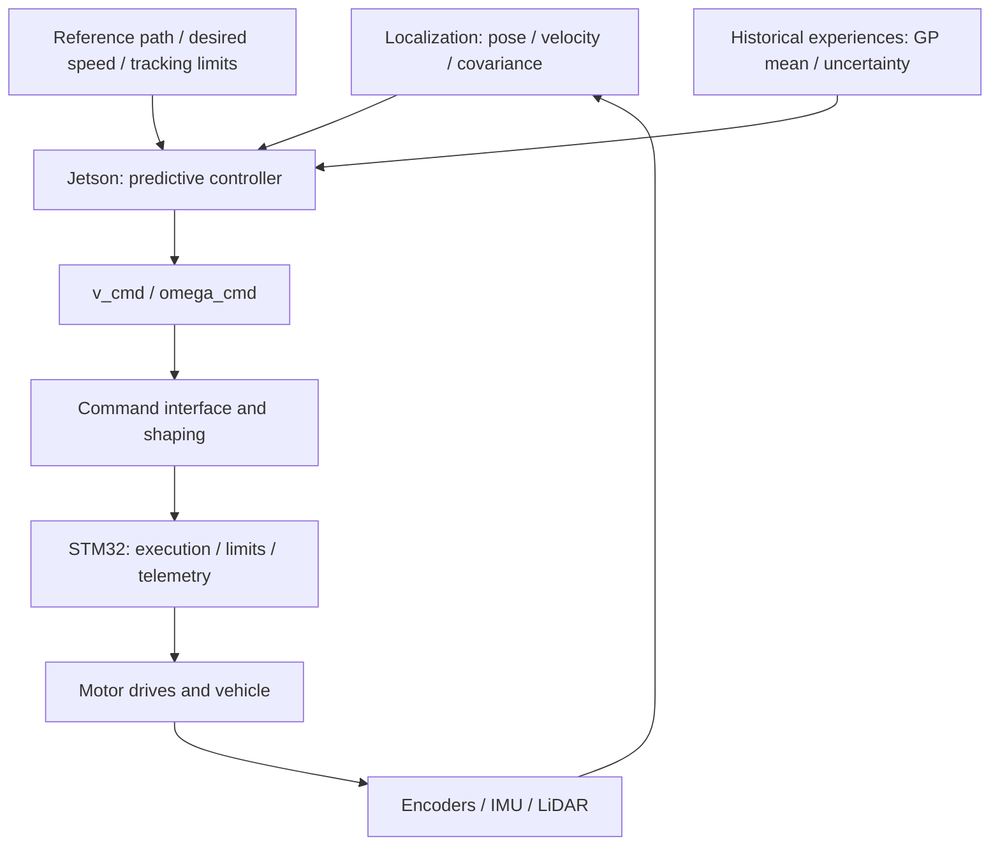

# 006 · RC-LB-NMPC：让 AMR 根据预测的不确定性选择速度

核查：2026-10-23｜论文：IJRR 2016｜状态：已读全文并对照现有 AMR 源码与历史 benchmark；未取得作者实现，未复现，也未在我们的 AMR 上运行该方法。

**论文：** Chris J. Ostafew, Angela P. Schoellig, Timothy D. Barfoot, *Robust Constrained Learning-based NMPC enabling reliable mobile robot path tracking*. The International Journal of Robotics Research, 35(13):1547–1563. [DOI / 出版社](https://doi.org/10.1177/0278364916645661) · [作者提供的全文 PDF](https://www.dynsyslab.org/wp-content/papercite-data/pdf/ostafew-ijrr16.pdf)

**快速跳转：** [原方法与问题](#context) · [四组公式](#math) · [代码怎样运行](#implementation) · [实验与证据边界](#experiments) · [怎样排除代码问题](#attribution) · [我们的 AMR](#our-amr) · [下一步研究判断](#research)

1. **它是什么？** 一个高层 path-tracking controller，完整名称是 **Robust Constrained Learning-based Nonlinear Model Predictive Control（RC-LB-NMPC）**。根据当前位置、路径、车辆模型与经验，决定接下来发出的 linear/angular velocity。
2. **旧方法已经会 learning 吗？** 会。此前的 LB-NMPC 已经用 Gaussian Process（GP）学习模型误差；这篇的重要扩展是把预测的 uncertainty 用来收紧 tracking constraints。
3. **想解决什么？** 在滑移、坡面和复杂车辆响应下，预测“平均会走到哪里”不够。平均预测没越界，实际车仍可能越界；始终按最坏情况开又可能太慢。
4. **怎么改？** 同时预测位置和 uncertainty。经验少、预测不确定时留大 margin；经验增加、模型更可靠时有机会缩小 margin，提高速度。
5. **实验说明什么？** 在作者报告的三个实验中，完整方法满足给定 tracking limits；第三个实验的五轮学习中，行驶时间相对自身第一轮减少接近 50%。这不是“比所有 baseline 快 50%”，也不是每轮必然更快。[§5，Fig. 8、11、16](https://www.dynsyslab.org/wp-content/papercite-data/pdf/ostafew-ijrr16.pdf#page=8)
6. **对我们的价值？** 可以学习如何把“预测不准”与“允许跑多快”连接起来。是否优于现有 MPPI、是否有必要引入，仍要由我们平台的实际问题与实验决定。

以下明确区分 **作者报告**、**教学例子**、**源码观察** 和 **建议实验**。这里的“四组公式”是为了理解而拆出的四个部分，不是作者发明了四个独立算法。

<a id="context"></a>

## 1. 从原方法开始：到底遇到了什么问题？

设想车已经能沿着一条教过的路径行驶。上层发 `v_cmd` 和 `omega_cmd`，底层 velocity controller 尝试执行。但“命令前进一段距离”与“车真的前进了多少”可能不同：轮胎打滑、地面倾斜、车辆与底层 controller 的响应都可能造成偏差。

作者此前的 **LB-NMPC** 把预测拆成两部分：简单的 nominal model，加上 GP 从历史数据学出的 disturbance。这里的 disturbance 指模型没解释掉的系统偏差，不只指外力。[前作：Learning-based Nonlinear Model Predictive Control to Improve Vision-based Mobile Robot Path Tracking](https://doi.org/10.1002/rob.21587)

**新问题在于：知道“平均偏多少”，还不等于知道预测有多可靠。** 假设预测 lateral error 是 6 cm，限制是 10 cm。只看 6 < 10 会觉得可行；但如果预测的 standard deviation 是 2 cm，那么按三倍 standard deviation 留 margin，6 + 3 × 2 = 12 cm，已经超出允许范围。这些数字是教学例子，不是论文实验数据。

RC-LB-NMPC 把 uncertainty 传播到未来轨迹，再据此收紧约束。optimizer 可以调整 linear/angular velocity，让未来轨迹符合这些更严格的条件。它并不是简单执行 `if uncertain: speed *= 0.5`。

| 方法 | 已有能力 | 剩下的问题 |
|---|---|---|
| Nominal NMPC | 根据固定模型预测，再优化指令 | 模型没有充分描述滑移或车辆响应 |
| 之前的 LB-NMPC | 用 GP 的预测均值修正模型 | 没有利用预测方差构造 robust state constraints |
| 固定 uncertainty 的 robust control 思路 | 对模型不准预留 margin | 经验增加后仍可能过于保守 |
| 本文 RC-LB-NMPC | 学习 disturbance 的均值与方差，并据此约束预测轨迹 | 依赖 uncertainty 是否可信、环境是否改变，以及优化能否实时完成 |

**这不是一篇“发现 UART delay，然后修好起步抖动”的论文。** 我们仓库中的时延与抖动记录是另一个系统问题，不能当作作者的原始动机。作者的实际实现确实把历史状态和指令放入 learned model，以表示车辆与底层速度环的动态响应；这也不等于专门识别通信时延。[§3.3–4.1](https://www.dynsyslab.org/wp-content/papercite-data/pdf/ostafew-ijrr16.pdf#page=6)

<a id="math"></a>

## 2. 四组公式：每一组在代码里负责什么？

先认变量，不必一开始就推导整篇。下面用 $s$ 表示 pose，以免向量与横坐标都叫 $x$；原文的 state vector 写作 $x$。这是符号重写，相关 Eq. 编号仍指原文。

| 符号 | 工程含义 | 常用单位 |
|---|---|---|
| $s_k=[x_k,y_k,\theta_k]^T$ | 第 $k$ 个采样时刻的 pose | m、m、rad |
| $u_k=[v_{\mathrm{cmd},k},\omega_{\mathrm{cmd},k}]^T$ | 上层给底盘的速度命令 | m/s、rad/s |
| $\Delta t$ | 离散模型的时间间隔 | s |
| $f$ | nominal motion model | 输出下一时刻 pose |
| $g$ | learned disturbance | 与 pose 增量同单位 |
| $\bar s,\mu$ | 预测或估计的 mean | 取决于对应变量 |
| $\sigma$ | standard deviation，反映 uncertainty | 与对应变量同单位 |
| $H$ | prediction horizon 的步数；原文用 $K$ | 无量纲 |

### 2.1 Motion model：先猜下一拍在哪里

原文 Eq. (24) 展开为：

$$
f(s_k,u_k)=
\begin{bmatrix}
x_k+\Delta t\,v_{\mathrm{cmd},k}\cos\theta_k\\
y_k+\Delta t\,v_{\mathrm{cmd},k}\sin\theta_k\\
\theta_k+\Delta t\,\omega_{\mathrm{cmd},k}
\end{bmatrix}.
$$

它只是在做 unicycle kinematics：朝当前方向走一段，再更新 heading。它没有详细描述车有多重、轮胎打滑多少，也没有完整描述 motor drive 的动态响应。

**教学例子：** heading 为 0，命令 1 m/s，$\Delta t=0.1$ s，nominal model 就预测下一拍向前 0.1 m。真实车只前进 0.08 m 时，这个差别可以成为 learning 的数据。

代码中对应 `predict_nominal(state, command, dt)`。这个模型既不是 PID，也不是 GP。

### 2.2 MPC optimization：比较未来几种走法，选一组指令

将未来 $H$ 步的 desired states、predicted mean states、desired inputs、candidate inputs 分别堆成 $S_d,\bar S,U_d,U$。原文 Eq. (3)、(7) 的核心写成：

$$
J=(S_d-\bar S)^TQ(S_d-\bar S)
 +(U_d-U)^TR(U_d-U),
$$

$$
U^*=\operatorname*{arg\,min}_{U\;\mathrm{feasible}}J.
$$

第一项衡量预测状态离参考轨迹多远；第二项衡量候选速度命令离 desired inputs 多远。$Q,R$ 是权重矩阵，不同量的单位与尺度需要匹配。第二项不能直接说成“jerk penalty”；这里也不只是惩罚速度命令本身的大小。

`feasible` 表示还要满足模型、state constraints 与 actuator limits。optimizer 给出一串指令，但只执行第一条；下一拍拿到新的 state estimate，再重新计算。这就是 **receding horizon**。

代码中对应 `solve_mpc(...)`，内部需要数值求解器。公式定义要解的优化问题，不会自动替我们解决初始化、数值误差、超时与 fallback。

### 2.3 GP disturbance model：记住模型错在哪里，并估计自己有多确定

完整运动预测使用原文 Eq. (2)：

$$
s_{k+1}=f(s_k,u_k)+g(a_k).
$$

这里 $a_k$ 是供 learned model 使用的 features。论文实际实现的 Eq. (25) 包括 pose、上一拍 actual velocity、当前与上一拍的 command，以帮助表示 first-order dynamics。

每次观测到新 pose，就能得到 Eq. (19) 的训练标签：

$$
\hat g(a_{k-1})=\bar s_k-f(\bar s_{k-1},u_{k-1}).
$$

左边是记录到的 prediction residual。右边的 $\bar s$ 来自 localization estimate，并非无误差的外部 ground truth。前面的例子里，nominal model 预测前进 0.1 m，localization 估计前进 0.08 m，那么这一维的标签为 −0.02 m。

**它不需要等任务失败才学习。** 正常完成任务时的 prediction residual 也可以作为 experience；但 timestamp、坐标系或单位有错时，残差也会被污染。

给定历史 residual 向量 $d$，Eq. (23) 的 GP prediction 可简写为：

$$
\mu_g(a_*)=k_*^TK^{-1}d,
\qquad
\sigma_g^2(a_*)=k_{**}-k_*^TK^{-1}k_*.
$$

这里 $K$ 是训练数据之间的 covariance matrix，$k_*$ 表示新输入与历史输入的 covariance，$k_{**}$ 是新输入的 prior variance。直观上，相似的历史经验帮助预测当前的偏差；训练覆盖、kernel 与噪声假设共同影响 uncertainty。

原文 Eq. (22) 采用 Squared-Exponential kernel，并带 measurement-noise 项。实现时必须统一 convention：若 $K=K_f+\sigma_n^2I$，预测 latent disturbance 使用 signal variance；若预测含 measurement noise 的 observation，还需要相应的 noise variance。不能把 library 返回的两种 variance 混用。数值代码一般解线性方程或做 Cholesky decomposition，而不是显式计算矩阵逆。

作者为 disturbance 的各维分别建 GP，假设各维 disturbance 不相关。论文将每轮收集到的 experiences 在轮末加入数据集；hyperparameters 在试验前根据已有经验 **offline** 选择。因此不能把它描述成“每次错了，就立刻在线重训全部参数”。[§3.3–3.4，Eq. (19)–(23)](https://www.dynsyslab.org/wp-content/papercite-data/pdf/ostafew-ijrr16.pdf#page=6)

### 2.4 Robust constraints：预测越不确定，留的 margin 越大

对每个未来时刻、每个受约束的 error 分量，Eq. (4)–(5) 将 uncertainty 转成更窄的允许区间：

$$
e_{\min}+\alpha\sigma_e
<\mu_e<
e_{\max}-\alpha\sigma_e.
$$

对于对称的一维界限，可直观写成：

$$
|\mu_e|+\alpha\sigma_e\leq e_{\max}.
$$

这是教学用的非严格不等式形式。论文选 $\alpha=3$。如果 error limit 为 10 cm，predicted mean 为 6 cm，standard deviation 为 2 cm，则三倍 margin 后不满足约束；若 standard deviation 降到 1 cm，则 6 + 3 × 1 = 9 cm，符合这一项限制。

**这里的 $\sigma_e$ 来自未来 state uncertainty 的传播。** 论文使用 Sigma-Point Transform，将当前 localization uncertainty 与 GP model uncertainty 逐步传播到预测状态；不能拿单个 GP 输出的 standard deviation 或 IMU covariance 直接代替全部轨迹 uncertainty。[§3.2，Eq. (11)–(18)](https://www.dynsyslab.org/wp-content/papercite-data/pdf/ostafew-ijrr16.pdf#page=5)

Gaussian 假设下约 99.7% 的三倍 standard deviation 区间，不等于“整条路线有 99.7% 的无碰撞保证”。多时刻、多维约束、模型偏差、uncertainty calibration 和未知障碍都会影响这种解释。作者也指出环境突变可能使 learned model 过度自信，例如夏天学过的路径突然积雪。[§6](https://www.dynsyslab.org/wp-content/papercite-data/pdf/ostafew-ijrr16.pdf#page=14)

<a id="implementation"></a>

## 3. 能不能全部写成代码？代码、配置、PCB 分别是什么角色？

能。运动预测、GP query、uncertainty propagation 和 constrained optimization 都需要由代码执行。JSON/YAML 可以保存权重、限值、kernel parameters 等配置，但配置文件本身不会执行控制算法。

下面是帮助理解的运行结构，**不是作者源码，也不是可直接部署的实现**：

```text
trial 开始前：
    从已有 experiences 选择 GP hyperparameters（论文是 offline）

每个 control tick：
    读取 timestamp 对齐的 state estimate 和 localization covariance
    读取参考路径、desired speed、tracking limits
    取出当前附近适用的历史 experiences
    在 optimizer 中反复评估 candidate command sequence：
        nominal model + GP -> 预测 motion
        Sigma-Point Transform -> 预测 mean 与 uncertainty
        计算 objective，检查 robust constraints 和 actuator limits
    执行最优 sequence 的第一条 v_cmd / omega_cmd
    记录 command、state、prediction residual 与求解状态

trial 结束后：
    将新 experiences 加入数据集，供后续 trial 使用
```

如果迁移到我们的平台，研究算法应运行在 **Jetson / 高层 controller**。底层 STM32 继续提供 command 接收、执行边界、轮速转换与 telemetry；motor drive 继续负责其内部控制。STM32 不需要承担 GP 或 NMPC optimization，但它的实际限幅、响应时间和反馈时序仍是高层模型必须面对的条件。



这张图是我们平台的拟议集成层次，论文自己的 localization 使用 **Visual Teach & Repeat（VT&R）**。控制器接入前，必须确认 smoother、限幅、接口采样周期与反馈 timestamp；它们会改变“optimizer 想执行的动作”与“车实际收到的动作”的关系。

作者用 Lenovo W530、Intel 2.6 GHz Core i7、16 GB RAM 同时运行 localization 与 controller，约 **10 Hz**；prediction horizon 为 **10 steps / 1 s**。第五轮累计超过 25,000 条 experiences 时，每次提取至多 180 条构建 local GP。这里提供了实时实现的先例，不能据此直接保证我们的 Jetson 实现能达到所需频率。[§4.2、5.1–5.2、5.5](https://www.dynsyslab.org/wp-content/papercite-data/pdf/ostafew-ijrr16.pdf#page=8)

<a id="experiments"></a>

## 4. 作者到底比较了什么？四组公式都单独验证了吗？

前两个实验比较的是三个 controller variants。作者说明它们求解相同的 optimization problem，区别主要在 state constraints；室内比较还明确说明 tuning 相同，仅约束不同。

| Variant | Learned model | State / path constraints | 利用 uncertainty 收紧约束 |
|---|---|---|---|
| LB-NMPC | 有 | 关闭 | 无 |
| C-LB-NMPC | 有 | 有 | 无，$\alpha=0$ |
| RC-LB-NMPC | 有 | 有 | 有，$\alpha=3$ |

这里“关闭约束”指关闭对应的 **state constraints**，不能扩大成“所有 actuator limits 也都取消”。这张对照表依据原文 §5.1。

| 实验 | 条件与重复口径 | 作者报告的结果 | 证据边界 |
|---|---|---|---|
| Experiment 1，Fig. 8–10 | 50 kg Husky，室内平坦混凝土、稳定照明；三种方法各三轮，经验逐轮累积 | 完整方法满足 tracking constraints；早期用更长行驶时间换取约束满足，学习后耗时接近其他版本 | 三轮 learning progression 不等于三次独立重置模型的统计重复 |
| Experiment 2，Fig. 11–14 | 900 kg Grizzly，松散地面，三种方法比较，结果展示十轮；反复行驶造成车辙 | 完整方法在作者报告的轮次中满足约束；其他版本早期会违反 lateral limit | 地面随试验改变，不能假设每轮环境完全相同 |
| Experiment 3，Fig. 15–18 | 900 kg Grizzly，900 m 室外路线，五轮；仅完整方法 | 随经验积累，行驶时间相对自身第一轮减少接近 50%，同时满足给定约束 | 不能写成对其他算法的 50% 优势；后期误差也不必趋于零 |

总测试覆盖超过 5 km。车辆的 50 kg / 900 kg 是论文描述的 robot mass，不能直接与我们尚未明确口径的“300 kg / 1000 kg”规格比较。[§5](https://www.dynsyslab.org/wp-content/papercite-data/pdf/ostafew-ijrr16.pdf#page=8)

**Fig. 8 怎么读：** 先看 maximum lateral error 是否超过给定 limit，再看 travel time。完整方法早期更慢，并不表示失败；它优化的目标包括约束满足。只比较速度，会漏掉这篇论文最重要的取舍。[Fig. 8，印刷页 1555 / PDF 第 9 页](https://www.dynsyslab.org/wp-content/papercite-data/pdf/ostafew-ijrr16.pdf#page=9)

**Fig. 16 怎么读：** 横轴是同一方法先后几轮的 learning progression。后面更快说明该设置下经验有帮助；它没有同时给出所有 baseline 的独立对照曲线。[Fig. 16，印刷页 1560 / PDF 第 14 页](https://www.dynsyslab.org/wp-content/papercite-data/pdf/ostafew-ijrr16.pdf#page=14)

### 这组实验能够支持到哪里？

它支持的是：在作者的设置中，仅约束预测均值仍可能过度自信；考虑 uncertainty 的约束能改善约束满足，同时 learning 有机会逐步降低保守程度。

**它没有把四组公式的独立贡献全部拆开。** Nominal model、optimization、learned disturbance、robust constraints 是组合起来运行的。三种方法都含 learning，因此这组比较不是完整的“learning 开/关”实验，也不能得出四个部分各贡献多少百分比。

有些部分存在依赖：去掉 motion model 后，原本的 MPC 就不再是可比较的同一个系统。要研究独立作用，可以替换为合理 baseline，或者做组合实验，但不能机械地删除每一行公式。组合本身可以是有效贡献，前提是论文的 claim 与实验能支持的范围一致。

还应保留三个限制：

- 误差评估使用 onboard VT&R localization；作者说明这些试验没有可用 GPS。引用过去的 VO 精度研究，不等于这些试验都有独立 external ground truth。
- 路径是预先 teach 的，Fig. 15 的 safe/unsafe 标注用于说明。论文没有完成一套实时 dynamic-obstacle detection 与 avoidance 系统。
- 本笔记未取得、运行或独立审查作者的实现，因此不声称已经排除了作者代码中的 bug，也不声称已确认不存在公开代码。

<a id="attribution"></a>

## 5. 怎么知道是方法有效，而不是代码刚好修好了？

算法必须通过代码运行，因此要分别回答两个问题：**代码是否正确实现了方法，以及实现正确后，这个方法是否带来额外收益。** 漂亮的公式和更好的曲线都不能单独解决这两个问题。

### 一个 embedded software 例子

假设 baseline 的 feedback timestamp 错了；新版本同时修复 timestamp 并加入 GP。新版本跑得更稳，不能全部归因于 GP，因为有两处变化。

至少需要比较：

| 配置 | Timestamp bug | GP | 用途 |
|---|---|---|---|
| 原始版本 | 有 | 无 | 记录旧问题，不能作为唯一 baseline |
| 修复后的 baseline | 已修复 | 无 | 衡量 bug fix 本身的作用 |
| 新方法 | 已修复 | 有 | 与上一行比较，才有机会判断 GP 的增量收益 |

这是我们建议的验证设计，不是对论文作者的指控，也不是说作者做过这组三行实验。

### Implementation correctness：代码有没有算对？

用可以手算的 motion-model 输入核对方向、单位与 $\Delta t$；在固定小数据集上把 GP mean/variance 与独立 reference 对齐；检查 covariance、角度 wrap、优化 constraint residual。对 solver timeout、infeasible result 和 fallback 单独记录，不应只留下成功轨迹。

这些检查发现的是实现问题。通过它们以后，仍需要 real-robot comparison 才能判断算法是否有实际收益。

### Algorithmic benefit：改进来自哪里？

比较时固定 firmware、state estimator、路径、load、速度限值、logging 与评价代码；记录 source commit、实际 binary identity 和 config。共同的 bug fix 应进入双方。对各 baseline 提供合理且可追溯的 tuning，避免只优化新方法。

若模块可独立开关，做 ablation；若怀疑两个模块相互作用，就比较合理的组合，而不是强行把提升分成互不相关的百分比。外部定位或独立传感器可用于检查是否只是 onboard estimate 看起来更好。

重复实验还要区分：**同一个模型越跑越有经验的 learning curve**，与 **从同一起点重新学习的独立 runs**。在可行时交错或随机安排条件，记录地面、load 与模型经历过的数据，报告失败、分布和不确定性。跑三次或十次本身并不能自动证明因果关系。

<a id="our-amr"></a>

## 6. 对照我们的 AMR：哪些已经有，哪些需要验证？

以下是截至 2026-10-23 的源码与文档观察，不是对新加坡现场二进制的确认。应用侧审阅 `onboard_test` 的 `992e5bd5725701d64ad46a6a58c7cfab9c94fcbd`；firmware 细读参考 `main` 的 `c6d46707007b4ea04241ad37d4796228f631ed5b`。两者不能自动视为同一套已部署组合。链接需要 company repository 权限。

### 6.1 我们现在是不是在做 PID？

| 层次 | 已读源码显示什么 | 与这篇论文的关系 |
|---|---|---|
| Jetson navigation controller | 所读 MPPI 配置为 20 Hz；也有模型时延参数与 command shaping | 与本文最接近的研究接入层；不能假定换上 RC-LB-NMPC 就更好 |
| STM32 command execution | 所读配置 control period 为 25 ms，status period 为 100 ms，command timeout 为 300 ms | 这些是配置与调度周期，不是实测 end-to-end latency |
| Body velocity → wheel targets | linear/angular velocity 转换为左右轮目标并处理限幅 | 属于 kinematics，本身不是 PID |
| 可选 yaw-rate correction | 有 PI 实现；所读 basic bring-up profile 默认关闭 | PI 没有 D 项；不能说“整个 STM32 默认靠这个 PI 跑” |
| Motor drive 内部 | 使用 drive velocity mode | 内部环的具体算法与 gains 不能仅靠上层仓库确认 |

证据：[MPPI 配置](https://github.com/BayroHubOrg/bayro-fleet/blob/992e5bd5725701d64ad46a6a58c7cfab9c94fcbd/bayro_robot/config/nav2_params_onboard_mppi_v10_final.yaml) · [firmware 配置](https://github.com/BayroHubOrg/bayro-fleet/blob/c6d46707007b4ea04241ad37d4796228f631ed5b/firmware/AMR_PCB/Core/Inc/app_config.h) · [motion conversion 与 yaw PI](https://github.com/BayroHubOrg/bayro-fleet/blob/c6d46707007b4ea04241ad37d4796228f631ed5b/firmware/AMR_PCB/Core/Src/motion_control.c)

MPPI 配置中的 `open_loop: true` 对应其内部速度预测的 anchoring 选择，不表示整车没有 localization feedback。旧注释中的 STM32 100 ms control cycle 也不能覆盖新 firmware 文件里的 25 ms 定义；判断现场行为还要读实际 firmware identity 和运行参数。

### 6.2 LiDAR / IMU fusion 能不能把“不准”补回来？

可以改善 state estimation，这是系统设计的重要手段。所读 EKF 配置组合了 wheel odometry 的部分 velocity、RF2O LiDAR odometry 的 differential 信息，以及 IMU yaw rate；不能概括成“IMU 所有数据都进入 EKF”。[EKF 配置](https://github.com/BayroHubOrg/bayro-fleet/blob/992e5bd5725701d64ad46a6a58c7cfab9c94fcbd/bayro_robot/config/ekf_params.yaml)

但“更准确知道现在在哪里”和“更准确预测这个命令之后会在哪里”是相互关联的两个任务。Fusion 不能物理上消除 wheel slip 或改变 braking distance；predictive control 也不能代替 localization。需要明确实际 controller 使用哪个 estimate，避免把同一份有偏 estimate 同时当作学习标签和唯一评价真值。

### 6.3 现有 benchmark 能复用什么？

仓库已有速度 tracking、起停与分相振动、到点、净空等分析基础，适合用来建立 controller comparison。它们并不全是论文里的 path-tracking error。

| 指标 | 单位 / 口径 | 在研究中回答什么 |
|---|---|---|
| Velocity tracking RMSE | m/s，需明确 command 与 measured velocity 对齐方式 | 指令执行与速度响应是否改善 |
| Lateral / heading error | m / rad，需统一路径投影与定位来源 | 车辆实际是否遵守指定 tracking corridor |
| D-ACC / D-DEC vibration | IMU high-pass acceleration standard deviation，m/s²；固定分相窗与滤波 | 改善速度或误差是否以载货平顺性为代价 |
| Travel time / effective speed | s / m/s，统一停顿、失败、完成条件 | 是否提高任务效率 |
| Clearance / violations / stops | m、次数、持续时间 | 快一些是否导致越界、贴障或更多 fallback |
| Prediction interval coverage / runtime | 覆盖率、区间宽度、ms、timeout rate；需要新增或明确记录 | uncertainty 是否可信、Jetson 是否满足 deadline |

证据：[历史 Round 8 报告，2026-08-19](https://github.com/BayroHubOrg/bayro-fleet/blob/992e5bd5725701d64ad46a6a58c7cfab9c94fcbd/docs/MPPI_ROUND8_RESULTS_0819.md) · [分析脚本](https://github.com/BayroHubOrg/bayro-fleet/blob/992e5bd5725701d64ad46a6a58c7cfab9c94fcbd/scripts/analyze_mppi_cells.py)

历史报告本身已经指出同配置复跑有散布、不同振动指标窗口会给出不同判断。这说明下一步应先固定测量口径，不能挑最好的一次当论文结论。本次所审阅 checkout 中未找到可用于独立重算的原始 rosbag；这里引用的是历史文档与分析代码，不是重新跑出的实测结果，也不代表旧问题至今仍存在。

<a id="research"></a>

## 7. 这能不能变成我们的 research？

**现有参数已经让产品在目标工况下工作良好，就不必为了写论文制造问题。** 值得研究的是：还有没有一个可重复、现有合理方法确实处理不好的条件，以及改进能否形成可迁移的方法和证据。

一个待验证的候选问题是：**load 或地面响应改变时，能否识别旧模型不再可信，暂时降低速度，并在重新学习后恢复效率，同时控制振动和 tracking violations？** 这与作者讨论的 distribution change 问题相连，但还不是已证明的新贡献，需要进一步 literature review 和基线实验。

合理的比较应包括当前已经调好的 MPPI、现有 load profiles、可行的 deterministic model / gain scheduling，再考虑 learned model 与 uncertainty-aware constraint 的增量价值。我们已有空载/载货参数切换，不能把“按载荷换参数”本身当作从零发明。

实施顺序可以是：

1. 确认实际 firmware identity、Jetson commit、config、质量/载荷口径与可用日志。
2. 先在 timestamp 对齐的数据上检查 nominal prediction residual，判断误差是否有可学习的结构；训练与测试按完整 run / load / surface 划分，避免相邻样本泄漏。
3. 离线比较预测均值与 interval coverage。这能检验 model，但 recorded actions 固定，不能证明新 controller 在 closed loop 中会更好。
4. 只有模型结果和实时计算开销支持时，再做受控的 controller experiments；同时报告效率、tracking、振动和失败。

更重的车型不自动意味着必须用这个方法；较轻车辆也可能有显著滑移或响应变化。是否值得做取决于实际工况、约束与 baseline 表现，而不是质量数字本身。

Engineering 与 research 也不是“工程可以融合多个传感器，研究只能盯一个轮子”。Sensor fusion、系统集成和降低成本都可能产生研究贡献；需要说明可推广的问题、方法与可信对照。若最终 claim 是更便宜，还应计入计算、标定、集成和维护成本，并在相同任务要求下比较，而不能只看 sensor BOM。

## 8. 继续精读的顺序与待核实项

先读 **Fig. 8 + §5.1**，理解三个版本究竟差在哪里；再读 **Eq. (19)**，把学习标签与我们能记录的数据对应起来；然后读 **Eq. (5) + Fig. 4**，理解 margin；最后再展开 **Sigma-Point Transform 与 solver 推导**。先能说清输入、输出、单位和实验，再逐层补数学，不需要一次看懂全部推导。

待核实：作者实现的可获得性与可复现范围；我们现场实际软件组合和原始日志；现有 controller 在目标工况是否真的有剩余问题；新车型“300 kg / 1000 kg”的质量与额定载荷口径；研究问题相对后续工作的 novelty。

主要文献：[IJRR 2016 全文](https://www.dynsyslab.org/wp-content/papercite-data/pdf/ostafew-ijrr16.pdf) · [IJRR DOI](https://doi.org/10.1177/0278364916645661) · [前作 JFR DOI](https://doi.org/10.1002/rob.21587)。本次记录的是这篇论文的阅读与平台映射，不是截至 2026 年的完整 AMR control survey。
