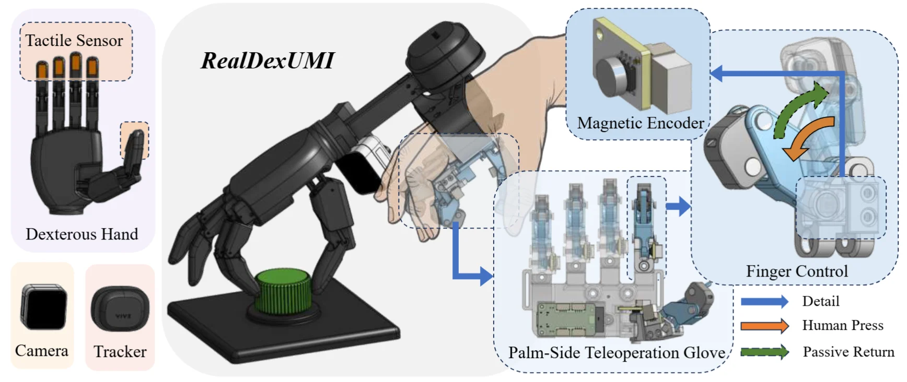
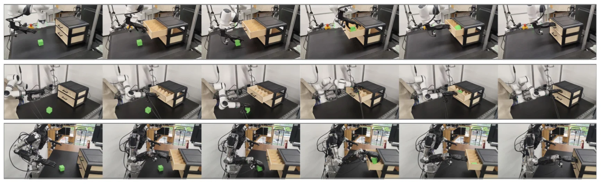

# RealDexUMI：保留同一只机械手，让采集与部署的接触接口一致

**[打开图片与视频播放页](media.html)** · 图片保存在本文件夹；视频播放页在线载入作者原视频。GitHub 的 README 不保证播放 HTML 视频，可在 Chrome 中打开 media.html，或使用文末官方链接。本机 Codex 内置浏览器播放原视频时出现崩溃。

核查：2026-10-21｜论文：arXiv:2606.06033v2｜状态：文献与公开资源分析，未复现。

项目定位更新（2026-10-22）：为 [Cadenza Robotics](https://github.com/Jeffaaay/cadenza-robotics) 的数据采集保留指令、状态与接触接口分析；当前先搭建 OpenArm 原结构平台，不将共享机械手模块视为已选硬件。

沿用现有 robotics-research-notes 的十一项问题。核心判断：它已有跨三种机器人复用检查点的证据，但前提是保留末端模块与策略接口；这不是任意换手的证明。

## 1. 它是什么？人究竟戴了什么？

它把机械手、近手相机、指尖触觉等做成共享末端模块。采集时人携带并操作这个模块，真正碰物体的是机械手；部署时把同一模块装到机械臂。掌侧机械接口让人的手指发出机械手可执行的指令。[官方系统介绍](https://research.beingbeyond.com/realdexumi)

因此，“人直接用自己的手完成任务，再把视频给任意机器人”不是这里的流程。“采集阶段不需要整条机器人手臂”也不等于不需要机器人机械手。

## 2. 它解决哪种失败？

原仓库已经指出两个问题：人手演示换成不同形状的机械手后，接触位置可能改变；手指被物体挡住时，只记实际角度会丢掉继续闭合的指令。

**教学例子：** 拿杯子时，手指停在杯壁上。实际状态为“不再弯曲”，操作者的命令却可能仍是“保持收紧”。如果把前者直接当成全部动作标签，策略学到的维持抓握意图可能不完整。这不是说位置控制必然无法抓杯子，而是强调必须检查指令、反馈和控制器的含义。

这与 Bunny 的区别主要在采集和部署的末端一致性，而不是单纯换了一个更大的网络。

## 3. 完整流程与自主输入输出

人操作模块 → 同步记录图像、触觉、手的指令与实际状态、跟踪器姿态 → 形成示范 → 训练策略 → 同一模块装上机械臂 → 策略根据当前观察发出下一段动作。

主实验使用 ACT。策略观察是近手 RGB、触觉、手状态；动作是手参考系下的相对位移、相对旋转和机械手命令。跟踪器用来生成训练动作标签，绝对跟踪姿态不作为策略观察。[论文 §3–4](https://arxiv.org/html/2606.06033v2)

**我们的解释：** 自主运行后是机器人运动学提供当前位置，不是还要人在旁边戴着采集模块指挥。采集时“人搬动模块”，部署时“机械臂搬动模块”，两者通过相同的末端参考系衔接。

## 4. 具体改动在哪里？

它保留同一模块的观察、接触表面和手动作接口，并同时记录指令与实际状态。[官方说明](https://research.beingbeyond.com/realdexumi)

硬件为六个主动自由度、十一个运动学自由度；操作接口有被动回位机构。不能把它等同于 DITTO-X 用电机主动带动人手的反馈外骨骼，也不能把十一自由度读成十一独立电机。[论文 §3](https://arxiv.org/html/2606.06033v2)

**我们的分析：** “同构”降低了动作映射歧义，同时把自由度和机械结构约束带进了示范。操作者能够轻松采集某种动作，仍然不代表模块能完成所有人类指法。

## 5. 为什么相对动作有助于换机械臂？

用一个自拟例子理解：策略说“从当前手的位置，沿手的前方再走一厘米”，不直接说“Panda 的第二关节转到某个角度”。

`目标手姿 = 当前手姿 × 预测的相对变化`

这是一种坐标变换的简写：前后两项都要使用约定一致的参考系。OpenArm 的 IK 再把目标手姿变成它自己的关节目标。

**这个表达解决了什么？** 不需要两条机械臂有相同关节角表示。

**它没有解决什么？** 目标仍可能够不到；IK 可能走到奇异位姿；低层延迟可能让手晚到；机械臂可能碰桌面。把动作写成相对量，只消除了部分坐标依赖，并没有消除物理差异。

## 6. 实验支持到哪一层？

以下核心数字已收录在原仓库 Bunny 笔记：八项任务，每项 200 条示范、20 次测试；完整方案平均成功率 88.75%，去掉触觉为 70%，用实测手状态替代指令标签为 51.25%。这是该系统内部消融，不是对 Bunny 的直接对战。[论文表 2](https://arxiv.org/html/2606.06033v2)

跨机器人测试保留同一模块和策略：FR3、RM65、Adam-U 上的抽屉任务分别为 85%、75%、80%；协议默认各 20 次测试。[论文表 3](https://arxiv.org/html/2606.06033v2) [官方跨机器人展示](https://research.beingbeyond.com/realdexumi)

**我们的解释：** 三者成绩不完全相同，恰恰提醒我们“同一策略能运行”和“同等性能”应分别验证。也不能用这几个任务证明所有动作、所有机械臂都适用。更换机械手会改变观察、动作和接触几何，属于比换承载机械臂更大的变化。

## 7. 复刻需要什么？公开到什么程度？

目前已核实论文和官方视频；官网没有提供可确认的该项目完整代码、CAD/BOM、数据与权重下载组合。页面顶栏的 GitHub 指向机构入口，不能算完整项目发布。论文表达了数据发布计划，计划不等于文件已可获取。

**我们的复刻依赖分析：**

| 应取得或核实的内容 | 为什么缺不得 |
|---|---|
| 手与操作接口的加工、装配和标定资料 | 保证采集指令与部署指令是同一种量 |
| 相机、触觉布局及数据格式 | 策略观察不仅是“都有图像”，还要空间和量纲一致 |
| 时间戳与同步规则 | 接触瞬间错配图像和动作，会产生错误示范标签 |
| 完整训练配置、数据划分及检查点 | 区分重建方法、训练成功和重现论文数值 |
| 机器人侧 IK、控制器和法兰变换 | 使同一相对动作在新机械臂上真正执行 |

在这些依赖未补齐前，不能把它列为现在即可完整安装运行的 OpenArm 工具链。GPU、显存和从零训练耗时尚无足够已核实信息供我们预算。

## 8. OpenArm 可不可以用？分四种主张回答

| 主张 | 当前判断 |
|---|---|
| 沿用相同的采集和训练思路 | 可以作为工程路线研究 |
| 同一末端模块装 OpenArm | 有移植依据，需要尺寸、负载、范围和控制适配 |
| 原策略在 OpenArm 上直接保持原成功率 | 未被这些实验证明 |
| 换成 LEAP 或另一只手仍直接用原策略 | 不能由跨机械臂实验推出 |

**我们的具体移植检查：** 先确定 OpenArm 版本及法兰到手参考系的变换；把预测相对运动交给 OpenArm 的 IK；检查轨迹连续性、时序、跟踪误差和碰撞；保持模块传感器接口一致，最后在同任务上做独立评估。若换手，则还要重建动作含义、触觉布局、视觉外观与示范，通常需要重新训练或适配。

OpenArm 官方当前文档为 2.0，标明每臂七自由度。该信息只帮助定义适配对象，不是上述检查已经通过的证据。[OpenArm 文档](https://docs.openarm.dev/)

## 9. 后续进展应该怎样追踪？

重点追踪实际代码、制造资料、数据和权重发布，以及更广泛的跨机器人测试。本次没有完成全部后续文献的系统检索，不能宣布已有某篇论文解决了所有局限。

论文明确讨论局部相机视野的不足。[官方限制说明](https://research.beingbeyond.com/realdexumi)

**我们的推断：** 琴键换位时，如果目标键暂时在画面外，单纯提升手指精度未必解决问题；可能需要更大的观察范围或可估计的键盘坐标。这是需要实验比较的设计方向。

## 10. 对平台研究与未来弹琴方向的价值

当前最直接的收获是把“指令”和“实际执行”分开记录，并确认时序、控制器和接触条件。OpenArm 夹爪碰到物体后，闭合指令与实际位置可能不同，需要先测量，再讨论数据表示的改进。

弹琴方向暂缓。若以后恢复，例如想按下 C、手指已到目标角度，但 MIDI 没有 Note On，这是三个不同层次的信息。

钢琴示范还必须能表达独立指法、换指和腕部运动。采用共享模块之前，要先观察其真实动作，检查是否能完成我们的音阶和和弦；不能因为论文叫 Universal 就跳过这一关。

候选验证：同一段短旋律，在同一手模块上比较只记录状态与同时记录指令、状态、MIDI的训练方式。评价应包括误按、漏按、起音和释放时间；是否值得做取决于硬件能力与先行基线，不是已经确定的论文方案。

## 11. 业界与术语对照

这里的 zero-gap 是末端采集与部署接口的一致性主张，不代表人和机器人的整体动力学没有差异。zero-shot 则描述某种测试条件下没有额外训练；必须说明没见过的是机器人、物体、环境还是任务。

它们都不是“任意机械臂兼容”的标准。公司展示与论文同条件实验也不能直接互换为性能排名。

## 图与视频：先看模块，再看机器人

图为作者素材。看清人的手指按在哪里、机械手在哪里、谁实际碰物体。

[打开官方项目和视频](https://research.beingbeyond.com/realdexumi) · [直接打开官方介绍视频](https://research.beingbeyond.com/realdexumi/videos/video_realname.webm)

观看时依次检查：采集时没有机械臂的场景；装到机械臂后模块是否保持一致；自主时人的手是否还参与；跨机器人展示换了什么；画面是否标注加速。演示视频不能替代逐次试验记录，本文未对全部录像逐帧评分。

### 补充图片与来源

图片来源：[硬件与采集接口](https://research.beingbeyond.com/realdexumi/images/system_overview.webp)。辨认人的操作接口、实际接触物体的机械手、相机与传感器。

换的是承载机械臂，保留的是同一末端模块和策略接口。 [作者原图](https://research.beingbeyond.com/realdexumi/images/cross.webp)
