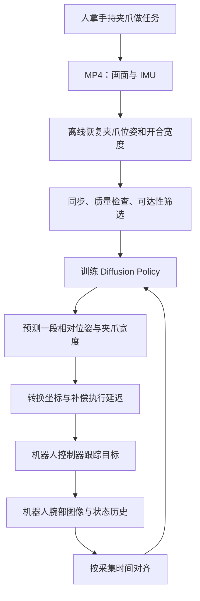

# UMI：从人手示范到机器人动作

**Universal Manipulation Interface: In-The-Wild Robot Teaching Without In-The-Wild Robots** · RSS 2024 · Cheng Chi、Zhenjia Xu 等

核查日期：2026-10-25。本文是 AI 辅助精读与工程分析，依据 arXiv v3 正文、附录、作者项目页和公开实现；未做实机复现，不代表用户已经读完或认可其中的判断。当前代码与 2024 年实验版本应区分。

[论文](https://arxiv.org/abs/2402.10329) · [全文与附录](https://arxiv.org/html/2402.10329v3) · [作者演示](https://umi-gripper.github.io/) · [开源实现](https://github.com/real-stanford/universal_manipulation_interface) · [今日阅读卡](https://github.com/Jeffaaay/robotics-paper-studio/blob/main/journal/2026-10-25.md)

**先抓住主线：人带着“像机器人夹爪的手持工具”做任务；系统恢复工具的运动和开合；模型学习看当前画面、预测接下来的一段夹爪动作。空间坐标和执行时间都必须接得上。**

阅读导航：[整体流程](#整体流程) · [硬件](#为什么这样设计硬件) · [数据](#视频怎样变成训练数据) · [学习方法](#模型到底在学什么) · [空间表示](#相对轨迹怎么理解) · [时间对齐](#为什么时间是核心问题) · [双臂](#两只手怎样协作) · [实验](#实验数字与证据边界) · [OpenArm](#对-openarm-叠衣项目的意义)

## 整体流程

图中训练和运行是两个阶段：先离线训练，部署时使用训练好的策略推理；机器人每走一段会重新观察，不是把演示视频对应的轨迹从头播放到底。

“Without In-The-Wild Robots”限定的是采集：不用把机械臂搬到每个示范现场。训练需要计算资源，部署需要真实机械臂、夹爪、摄像头和控制器。手持设备也不是任意普通人手视频：它专门让采集时与机器人运行时的末端形态、视角、动作接口尽量一致。

这里的 universal 是接口的可复用性。论文用同一框架处理不同任务；不能读成一个现成模型已经同时学会所有任务，也不是输入一句自然语言就能执行任意家务。相关定位见[论文 I–III](https://arxiv.org/html/2402.10329v3#S1)。

## 为什么这样设计硬件

| 部件 | 帮助解决的问题 | 理解时要保留的边界 |
|---|---|---|
| 手持平行夹爪 | 人在示范时就使用接近机器人末端的操作方式 | 夹爪仍不像人手灵巧；人能做的轨迹也可能超出机器人能力 |
| 与指尖固定相对位置的腕部 GoPro | 减少采集画面和部署画面的视角差异 | 相机位置、指尖外形和工具坐标仍需正确配置 |
| 155° 鱼眼镜头 | 近距离操作时仍能看到周边目标 | 模型直接使用鱼眼图；强行拉直会改变中心/边缘的信息分配 |
| 两侧小镜子 | 一个画面中包含不同光学视点，补充遮挡与深度线索 | 隐式立体信息不等于输出经过标定的深度图 |
| 摄像头内置 IMU | 为位姿恢复补充角速度、加速度和尺度约束 | 有漂移、初始化和纹理条件，不能当作真值 |
| 连续夹爪宽度、软指尖 | 控制接触和释放过程，而不仅是开/关 | 柔顺变形可以间接关联力，但没有直接测出精确接触力 |

这里有一个很好理解的例子：如果人用五指拧住布料，但机器人只有两片夹爪，即使把人手位置估计得完全正确，接触方式仍不一样。让人先用相似夹爪做，能从数据源头减少这类差异。

镜子还有一个容易漏掉的预处理：作者把镜内图像翻转并交换左右镜区域，避免主图和镜图呈现相反方向的运动。不能据此推断所有视觉网络都必须用镜子；它是该配置中经过消融验证的设计。[方法 III-A、实验 V-A](https://arxiv.org/html/2402.10329v3#S3.SS1)

论文当时报告每只手持设备约 780 g，夹爪部分 BOM 73 美元、相机及配件 298 美元，合计约 371 美元。这是 2024 年论文的采集设备成本，不是今天的采购报价，也不包含机器人、训练计算和全部部署设备。

## 视频怎样变成训练数据

一个训练样本需要回答两个问题：“当时看见了什么、处于什么状态？”以及“接下来示范者怎么动？”因此，光有好看的视频不够，还要有与画面对齐的动作标签。

采集时先为场景建立地图，再录制一段段操作。视觉与惯性 SLAM 恢复相机运动；相机与夹爪刚性相连，就可以把运动换算为夹爪位姿；夹爪上的视觉标记用于恢复宽度。双手视频还需要时间同步，并重定位到同一张地图中。作者的 ORB-SLAM3 改动包括用已有地图初始化、允许随后继续优化，以及建图时可选用已知尺寸标记帮助初始化。示范阶段并不要求桌面保留该建图标记。[附录 B、D](https://arxiv.org/html/2402.10329v3#A0.SS2)

用自己的符号写，一个时刻可以整理成：

\[
o_t=\{I_{t-h:t},\ T_{t-h:t},\ w_{t-h:t}\},\qquad
A_t=\{(T_{t+k}^{\rm target},w_{t+k}^{\rm target})\}_{k=1}^{H}.
\]

- \(I\)：图像；\(T\)：位置和朝向合起来的 pose；\(w\)：夹爪宽度。
- \(h\)：保留多长历史；\(H\)：预测多长未来；这里是教学记号，不是原文公式编号。
- 历史有意义：同一张静态画面可能对应“正靠近”或“正离开”，前一时刻的位置能帮助区别运动方向。

还要过滤跟踪失败和不适合目标机器人的轨迹。手持设备不会受到机械臂关节限位约束，所以“采集时没机器人”并不意味着“数据可以原封不动交给任意机器人”。

**采集中的 SLAM 与部署中的状态读取是不同环节。** 作者当前实现把离线 SLAM 结果转为 Zarr 数据集；部署则从机器人状态接口读取末端位置和旋转，再构造相对观测。不能把整个运行系统想成机器人始终靠离线 SLAM 来控制自己。[数据处理说明](https://github.com/real-stanford/universal_manipulation_interface#running-umi-slam-pipeline)、[部署观测转换](https://github.com/real-stanford/universal_manipulation_interface/blob/main/umi/real_world/real_inference_util.py)

## 模型到底在学什么

UMI 的实验使用 **Diffusion Policy**。这是模仿学习中的动作生成器：学习在给定观察时，人类示范中有哪些合理的未来动作序列。

用一个独立教学例子理解：桌上障碍物左边、右边都能绕过去。如果一半示范向左、一半向右，直接回归平均轨迹可能恰好走到障碍物上。我们需要表达“有两个合理选择”，并形成连贯的一条路径。

Diffusion Policy 的训练把示范动作序列加噪，再学会根据画面和状态去掉噪声；推理时由噪声逐步生成有条件的动作序列。生成对象是机器人动作，和生成视频的扩散模型在输出含义上不同。动作序列执行一部分后再观察、再预测，形成 receding-horizon 的闭环。该机制来自 [Diffusion Policy 原作者说明](https://diffusion-policy.cs.columbia.edu/)。

抽象表达为 \(A_t\sim p_\theta(A\mid o_t)\)。其中 \(\theta\) 是训练得到的参数，\(A_t\) 是一段动作；不是环境未来图像，也不是直接的电机电流。最终仍需要控制器把末端目标落实为各关节运动。

“多模态动作”这里指多个动作分布峰值，不是“图片+文字”的多种输入模态；CLIP 被用作部分任务的视觉特征初始化，也不能据此认定系统有通用语言指令能力。

从作者当前代码看，每只夹爪的网络动作包含 3 个位置量、6 个旋转表示量、1 个宽度量，转换后交给运行环境的是 3D 位置、3D 轴角和宽度。**10 个网络数值不等于机器人有 10 个自由度**，6D 旋转表示也不是 6 个旋转自由度。[动作转换代码](https://github.com/real-stanford/universal_manipulation_interface/blob/main/umi/real_world/real_inference_util.py)

## 相对轨迹怎么理解

先忽略旋转，假设夹爪现在位于某一条轴的 50 cm 处，下一段想去 52、54、55 cm：

| 表示 | 给模型的目标 | 容易出现的问题 |
|---|---|---|
| 绝对坐标 absolute | 52、54、55 cm | 更换场景原点、基座位置后，同一组数的含义可能变了 |
| 逐步增量 delta | +2、+2、+1 cm | 逐步累积时，早期误差会影响后面的参考位置 |
| 固定起点的相对轨迹 relative | 相对当前 50 cm：+2、+4、+5 cm | 仍需准确状态与正确坐标转换，但整段共享一个起点 |

关键是 **relative 的每一步都参考这次推理的同一个起点**，不是每次参考上一步。下一次重新观察、重新推理时，再换一个起点。

完整空间中用齐次变换：

\[
T=\begin{bmatrix}R&p\\0&1\end{bmatrix},\quad
\Delta T_k=T_0^{-1}T_k,\quad
T_k^{\rm target}=T_0\Delta T_k.
\]

\(R\) 是朝向，\(p\) 是位置，\(T_0\) 是本轮观察对应的夹爪位姿。换坐标不仅是减去位置；还要把方向转到同一个参考系。作者当前 `relative` 分支直接实现这一矩阵乘法。[实现](https://github.com/real-stanford/universal_manipulation_interface/blob/main/diffusion_policy/common/pose_repr_util.py)

这有利于共享“末端如何相对移动”的技能，但不会替新机器人解决逆运动学、碰撞或关节限位。论文中绝对坐标基线较差，还混有 SLAM 到机器人基座标定不准的问题，不能推广为“绝对动作在任何任务都不如相对动作”。

## 为什么时间是核心问题

工程上必须区分四个时间：画面实际拍摄、电脑收到画面、模型完成推理、机器人真正到达目标。把它们都叫“现在”，就会把数据关系弄错。

**以下数字是教学例子，不是论文测量值。** 假设电脑在 10.00 s 收到一帧拍于 9.85 s 的画面，但刚收到的关节状态对应 9.99 s。直接拼接时，模型看的是过去的物体，配的却是之后的手臂状态。对于抓取或扔球，0.14 s 的时间错位可能足以改变接触关系。

观察对齐的做法是按图像的采集时间，到缓冲区中取出或插值出同一时刻的手臂和夹爪状态。它得到一致的历史状态，不会神奇地产生“此刻的无延迟图像”。

随后模型预测从该观察时刻开始的一段动作。假设预测针对 9.95、10.05、10.15、10.25、10.35 s；推理在 10.04 s 才结束，机械臂还有 0.10 s 执行延迟，则很早的目标已经来不及实现。合理处理是丢弃过期目标，保留仍能按时到达的未来目标。

对于同一个希望到达的时间 \(\tau\)，教学公式是：

\[
t_{\rm send,arm}=\tau-L_{\rm arm},\qquad
t_{\rm send,gripper}=\tau-L_{\rm gripper}.
\]

例如希望 10.30 s 到达目标，机械臂延迟 0.10 s、夹爪延迟 0.12 s，就分别在 10.20 s、10.18 s 提交对应命令。目标是**实际动作同时发生**，不要求发命令同时发生。

作者部署代码显式包含相机、机械臂与夹爪延迟，按观测时间生成动作时间戳，并筛选尚未过期的目标。[推理循环](https://github.com/real-stanford/universal_manipulation_interface/blob/main/eval_real.py)、[硬件配置](https://github.com/real-stanford/universal_manipulation_interface/blob/main/example/eval_robots_config.yaml)

延迟怎么测，以及这种补偿做不到什么

附录 A 的方法：用不断更新的时间戳二维码测摄像头到电脑的端到端延迟，并扣除显示器刷新延迟；状态流有可信时间戳时直接比较，无时间戳时以半个 ping 往返时间近似通信延迟；对指令与测得的运动曲线做时间平移对齐，估计端到端动作延迟，再扣掉状态反馈延迟。

这仍是近似。网络不对称会影响半 ping 假设；电机延迟会随负载、动作幅度和控制设置变化；延迟抖动无法总由一个常数补偿。换 OpenArm 后应重新测，不能照抄作者 UR5 的参数。

提高 FPS、缩短模型推理时间都可能有帮助，但都不能替代跨传感器时间对齐。相反，即便网络预测正确的几何路径，错过释放时刻也会改变扔球的落点。

## 两只手怎样协作

叠衣时，一只手可能已经捏住左下角，另一只还在找右下角。如果左手先抬起来，布料会把右侧目标位置拖走。“各自看懂自己相机里的衣服”还不够，需要知道另一只手相对自己的位置。

如果两手在同一个坐标系中的位姿分别是 \(T_L,T_R\)，则右手在左手坐标系中的位姿可写为：

\[
T_{L\leftarrow R}=T_L^{-1}T_R.
\]

采集时可由共享地图关联两只手。部署时则需关联两台机器人的基座坐标，再用各自的末端状态计算。作者当前配置确实包含 `tx_left_right`，因此项目网页的“calibration-free”不能扩展成“两台机械臂之间什么空间关系都不用知道”。[部署配置](https://github.com/real-stanford/universal_manipulation_interface/blob/main/example/eval_robots_config.yaml)

论文的叠衣使用一个集中式策略输出两臂与两夹爪的动作。观察到的协作行为包括先到预抓位置、等待另一侧就位，再一起抓和折；这是学到的行为，论文没有把它作为一个带形式化保证的手写同步屏障。[实验 V-C](https://arxiv.org/html/2402.10329v3#S5.SS3)

## 实验数字与证据边界

下面是作者报告的数据，均未由我们复现。训练示范数与评估次数是不同概念；扔物体的分母尤其不能当成 episode 数。

| 任务 | 训练示范 | 主要评估结果 | 对照 / 消融 |
|---|---:|---:|---|
| 实验室杯子摆放 | 305 | UR5：20/20；同 checkpoint 的 Franka：18/20 | 去鱼眼 11/20；delta 16/20；绝对坐标 5/20 |
| 动态抛掷分类 | 280 | 105/120 个物体成功，87.5% | 关闭时延匹配：69/120，57.5% |
| 双臂毛衣折叠 | 250 | 14/20，70% | 无双夹爪相对位姿：6/20，30% |
| 双臂洗盘子 | 258 | CLIP ViT：14/20，70% | 从头训练 ResNet-34：0/10 |
| 新场景杯子摆放 | 1,400，30 个采集地点 | 合计 43/60，71.7% | 同类预训练视觉骨干只用单场景数据：0/20 |

来源：[正文 V–VII、图 8–9](https://arxiv.org/html/2402.10329v3#S5)。

**成功定义决定如何解读百分比。** 杯子要站在碟子上且把手朝规定方向 ±15°；抛掷物体碰到底部后弹出仍可算成功，某些失败后重试成功也可计入；毛衣的袖子收进、最终轮廓接近规定方形即可，未要求每处平整；洗盘子的评价允许小于约 5 mm 的残留点。作者人工判定，并明确承认主观成分。[附录 C](https://arxiv.org/html/2402.10329v3#A0.SS3)

读这些证据时，我会保留下面几个判断：

- 14/20 意味着这组测试仍有 6 次失败，不能只把“70%”当作一个很高或很低的标签。
- 20/20 证明的是这 20 个试次都成功，不能据此给开放环境中的下一千次操作做可靠性保证。
- 抛掷消融关闭了多类时间匹配。它支持整套时间处理有用，不能单独分配“相机对齐贡献多少、夹爪补偿贡献多少”。
- 洗盘子对比同时改变视觉网络架构和预训练条件，不能当成严格证明“ViT 架构本身导致全部收益”。恢复演示也确实在训练数据中，不能把恢复行为描述为完全无示范涌现。
- 泛化实验同时改变了数据量和采集场景数量。它支持增加多样数据的效果，但没有完全隔离“数量”与“多样性”的独立贡献。
- 新场景评估是杯子任务的两个场所，未证明所有四项任务都有同等跨场景能力，也未证明新任务泛化。
- 两只没见过的杯子结果是 15/20；见过的杯子在新场景是 28/40。不能因为 75% 高于 70% 就说模型更擅长陌生物体。
- 正文 VI 写采集涉及 15 款杯子，附录图 A2 写 18 款训练、2 款测试；原文两处统计口径未解释一致，因此不把训练杯子的精确数量作为确定结论。

### 数据质量与采集效率

杯子任务的短时采集比较折算为 UMI 111 次/小时、SpaceMouse 遥操作 35 次/小时、裸手 231 次/小时，计入复位、随机化和故障处理。它不是对所有遥操作设备、所有操作者的普遍排名。[项目页](https://umi-gripper.github.io/#data-collection-methods)

跟踪基准报告：单夹爪轨迹平均位置误差 6.1 mm、旋转 3.5°；两夹爪相对位置误差 10.1 mm、旋转 0.8°。均值不是最大误差，也不是末端最终任务误差。尤其不能将图注的概括理解成所有双臂误差都严格小于 1 cm。[图 12、VII](https://arxiv.org/html/2402.10329v3#S7)

### 实现与计算规模

| 论文配置 | 图像历史 / 状态历史 | 视觉骨干 | 环境频率 | 相对示范的执行速度 |
|---|---|---|---:|---:|
| 杯子 | 2 / 2 | CLIP ViT-B/16 | 10 Hz | 0.5× |
| 抛掷 | 2 / 2 | ResNet-34，从头训练 | 20 Hz | 1× |
| 叠衣 | 2 / 2，双摄像头 | ResNet-34，从头训练 | 10 Hz | 0.5× |
| 洗盘子 | 2 / 2，双摄像头 | CLIP ViT-B/16 | 10 Hz | 0.5× |
| 野外杯子 | 1 / 2 | CLIP ViT-L/14 | 10 Hz | 0.5× |

表 A1 的 action horizon 为 6，图像为每视角 224×224，DDIM 配置为 50 个训练扩散时间步、16 次推理迭代。环境频率不是底层电机伺服频率；也不能不看脚本就把 horizon=6 理解成每轮完整执行六个新动作。早期动作可能已过期，实际执行还受推理循环配置影响。抛掷不能随便减速，因为释放速度决定弹道。[附录 E、表 A1](https://arxiv.org/html/2402.10329v3#A0.SS5)

论文使用多 GPU 训练；作者当前 README 也提供经过 RTX 3090 24GB 测试的单 GPU 训练入口。因此应分别看待“论文使用的计算规模”和“最小可开始尝试的配置”，不能直接推断必须买多张 A100。[作者训练说明](https://github.com/real-stanford/universal_manipulation_interface#training-diffusion-policy)

## 对 OpenArm 叠衣项目的意义

以下是针对当前固定桌面、双臂 OpenArm 加夹爪路线的工程判断，不是作者在 OpenArm 上做过的实验。

**最值得学习的是接口设计和验证顺序。** 可以先定义一个小而明确的任务，例如固定款式、初步铺展、只改变少量平移旋转的 T 恤折叠，然后检查数据中是否有机器人运行时确实能获得的观察和动作。不能直接把毛衣结果当成 T 恤、任意材质或从揉乱衣堆开始的基线。

1. **先检查末端接触。** 相机相对指尖的位置、指尖外形和柔顺性、夹爪开口、桌面接触，都可能影响数据迁移。只换机械臂而保留相同末端，和连夹爪、镜头一起换，难度不同。
2. **先验证运动接口。** 确认目标位姿能否被准确跟踪，双臂共有工作区够不够，限位、速度和碰撞条件是否满足；再谈学习策略的表现。
3. **建立可追溯的时间。** 保存图像采集、状态采集、命令提交与到达时间，测量自己的时延和抖动。不能把“在同一台电脑上运行”当成同步已经解决。
4. **显式提供双手关系。** 两只腕部相机加相对末端位姿，是一个值得先验证的输入方案。用固定种子或固定初始场景做有/无该输入的比较，才能知道它对自己的任务有多大作用。
5. **记录失败类别。** 看不见衣角、没有夹住、夹住后滑脱、两手抬起不同步、触发限位、最终折形不合格，应分开统计；同一个总成功率无法定位改进方向。

对固定桌面的小规模起步，UMI 的野外采集优势未必是第一优先级。如果已有双臂遥操作可用，可以先借鉴时间、动作表示与协作输入，再判断何时值得引入完整手持采集流程。是否采用仍取决于自己的数据质量、成本和实机测试。

### 读完后应该能用自己的话回答

1. 为什么普通人手视频不等于可直接训练机器人策略的示范？
2. Relative trajectory 与逐步 delta 有什么不同？
3. 为什么最新图像与最新关节状态直接拼接可能有问题？
4. 为什么想让双手同时抓住衣角，可能要在不同时间发送命令？
5. UMI 的 70% 叠衣成功率，具体支持与不支持哪些结论？

后续个人笔记应记录用户自己的解释、异议和项目联系。公开内容若要讲这一篇，最好从用户真正关心的一点出发；以上分析不自动成为用户的第一人称观点。
